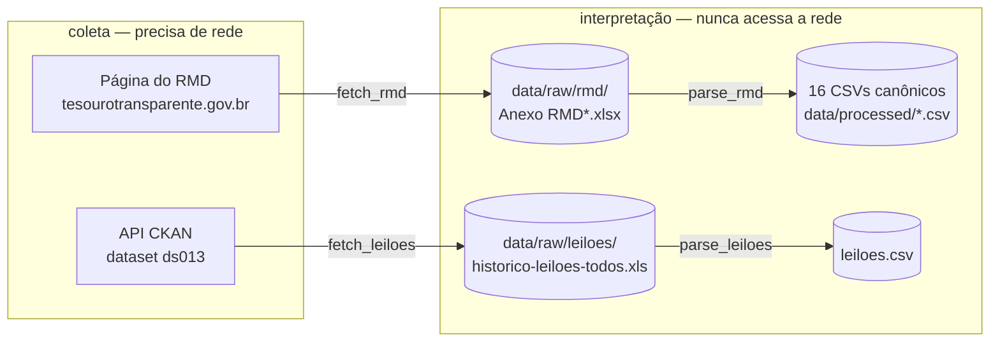

# Fontes de dados

## Fluxo

A fronteira entre os dois retângulos é a decisão de arquitetura central do
projeto: à esquerda dela há rede (`fetch_rmd.py`, `fetch_leiloes.py`); à
direita não (`parse_rmd/*.py`, `parse_leiloes.py`). Em ambiente fechado,
alguém preenche `data/raw/` na mão (`docs/como-baixar.md`) e tudo à
direita funciona sem alteração de código — é o `--sem-coleta` do
`tesouro.pipeline`.

## RMD — Relatório Mensal da Dívida

Página: `tesourotransparente.gov.br/publicacoes/relatorio-mensal-da-divida-rmd/{ano}/{mes}`

O anexo com as tabelas fica num servidor de arquivos com identificador
numérico que muda a cada publicação — não há URL previsível, por isso o
coletor abre a página do mês e extrai o link de lá (`fetch_rmd.link_do_anexo`).
Se o anexo vier num `.zip`, o coletor extrai o `.xlsx` de dentro.

Quase todas as abas trazem a série histórica completa, então basta o RMD
mais recente. A exceção é a aba 3.4, que é um retrato substituído a cada
mês — ver a nota sobre `cronograma_vencimentos` no dicionário de dados.

## Leilões

API: `tesourotransparente.gov.br/ckan/api/3/action/package_show?id=ds013`

O arquivo único (`historico-leiloes-todos.xls`, ~5 MB) traz uma aba por
ano desde 2000, todas com o mesmo layout. É `.xls` legado, que exige a
biblioteca `xlrd`. Se ela não estiver disponível no ambiente de destino,
o contorno está em `docs/como-baixar.md`.

## Limite de cobertura: bandas do PAF

A aba 5.7 do RMD (origem de `paf_metas`) traz as bandas mínimo/máximo do
Programa Anual de Financiamento **apenas de 2003 a 2022**. O último bloco
da aba cobre 2021–2022 e o Tesouro parou de estendê-la — confirmado no
anexo de junho/2026. Quem for comparar a dívida contra a banda do PAF em
anos recentes (2023 em diante) vai precisar extrair as bandas dos PDFs do
PAF publicados a cada ano; essa extração **não está nesta camada de
dados**.

A aba registra revisões de meta nos anos de **2008, 2015, 2016 e 2021**
(coluna `versao` = `revisado` em `paf_metas.csv`), mas não traz a data em
que cada revisão foi publicada — só o ano e os novos limites. Quem
precisar da data de vigência de uma revisão terá de buscá-la em outra
fonte.

## De onde vem cada CSV

| CSV | Aba do RMD |
|---|---|
| `funding_por_canal` | 1.1 |
| `funding_por_indexador` | 1.2 |
| `estoque_dpf` | 2.1 |
| `estoque_titulos_vencimento` | 2.2 |
| `composicao_dpf` | 2.4 |
| `detentores` | 2.7 |
| `detentores_por_titulo` | 2.8 |
| `vencimentos_faixa` | 3.1 |
| `vencer_12m_indexador` | 3.3 |
| `cronograma_vencimentos` | 3.4 |
| `prazo_medio_por_titulo` | 3.7 |
| `prazo_medio_por_indexador` | 3.8 |
| `prazo_medio_emissoes` | 3.9 |
| `custo_medio` | 4.1, 4.2 e 4.3 |
| `paf_metas` | 5.7 |
| `reserva_liquidez` | 6.1 |
| `leiloes` | (dataset ds013) |

Detalhes de cada coluna, tipo e armadilha conhecida estão em
`docs/dicionario-de-dados.md`.
