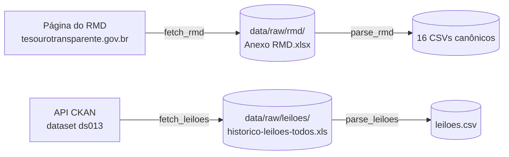

# Camada de Dados do Tesouro — Plano de Implementação

> **For agentic workers:** REQUIRED SUB-SKILL: Use superpowers:subagent-driven-development (recommended) or superpowers:executing-plans to implement this plan task-by-task. Steps use checkbox (`- [ ]`) syntax for tracking.

**Goal:** Baixar os dados públicos do Tesouro Nacional (anexo do RMD e histórico de leilões) e convertê-los em 17 CSVs canônicos, limpos e documentados.

**Architecture:** Coleta e interpretação ficam fisicamente separadas — `fetch_*` baixa para `data/raw/`, `parse_*` lê só de `data/raw/` e escreve em `data/processed/`. Nenhum parser conhece a internet, o que permite rodar o projeto em ambiente sem rede colocando os arquivos na mão. As 18 abas do RMD caem em dois padrões de layout, atendidos por dois leitores genéricos, mais três abas especiais com parser próprio.

**Tech Stack:** Python 3.12, pandas, openpyxl (`.xlsx`), xlrd (`.xls` legado), pytest. Sem dependências além dessas.

**Spec:** `docs/superpowers/specs/2026-08-14-camada-de-dados-design.md`

## Global Constraints

- **Bibliotecas permitidas:** apenas `pandas`, `openpyxl`, `xlrd`, `matplotlib`, `pytest`. O destino é um banco com restrição de instalação; nada além disso entra sem decisão explícita.
- **Unidade monetária única:** todos os valores em **R$ milhões**. O RMD mistura milhões e bilhões entre abas; leilões vêm em reais.
- **Percentuais como percentual:** `12.5` significa 12,5%. O arquivo de leilões traz frações (`0.125`) e precisa ser convertido.
- **Datas em `AAAA-MM-DD`**, sempre no último dia do mês de referência.
- **Ausente é vazio, nunca zero.** O RMD usa `N/D` (aba 3.1), `-` (aba 3.9) e células em branco; leilões usam branco.
- **Nada derivado é gravado.** Percentuais de composição, médias móveis, acumulados e participações são calculados na análise, não persistidos. Onde uma aba traz o par (valor, %), grava-se apenas o valor.
- **Formato longo**, nunca largo: `data` + dimensões + `valor`.
- **`data/raw/` é imutável.** Nenhum código escreve, move ou apaga arquivo lá dentro.
- **Idioma e codificação:** os arquivos `.py` são **inteiramente ASCII**, inclusive comentários e docstrings (`data_referencia`, `valor_milhoes`, `# converte para o fim do mes`). Os arquivos `.md` de documentação usam português acentuado normalmente. Motivo: o projeto vai rodar em ambiente Windows corporativo, onde a codificação padrão do console e de editores varia entre UTF-8 e cp1252 — código-fonte só-ASCII elimina uma classe inteira de falha que aparece longe da causa. **Isto não vale para dados:** valores lidos das fontes preservam seus acentos (`Índice de Preços`, `Câmbio`, `Oferta Pública`), inclusive quando aparecem como literais em testes e em dicionários de mapeamento.

---

## Estrutura de arquivos

```
src/tesouro/
├── __init__.py
├── config.py                    # caminhos e constantes
├── conversoes.py                # data, unidade, nulo, percentual
├── leitura_rmd.py               # leitores genericos padrao A e padrao B
├── fetch_rmd.py                 # baixa o anexo do RMD
├── fetch_leiloes.py             # baixa o historico de leiloes
├── parse_leiloes.py             # leiloes.csv
└── parse_rmd/
    ├── __init__.py              # orquestra todos os parsers
    ├── funding.py               # abas 1.1, 1.2
    ├── estoque.py               # abas 2.1, 2.4, 2.7, 2.8
    ├── estoque_vencimento.py    # aba 2.2 (especial)
    ├── vencimentos.py           # abas 3.1, 3.3, 3.4 (3.4 especial)
    ├── prazo.py                 # abas 3.7, 3.8, 3.9
    ├── custo.py                 # abas 4.1, 4.2, 4.3 (consolidadas)
    └── paf_reserva.py           # abas 5.7 (especial), 6.1

tests/
├── conftest.py
├── fixtures/
│   ├── gerar_fixtures.py        # recorta amostras dos arquivos reais
│   ├── rmd_amostra.xlsx
│   └── leiloes_amostra.xls
├── test_conversoes.py
├── test_leitura_rmd.py
├── test_parse_leiloes.py
├── test_funding.py
├── test_estoque.py
├── test_estoque_vencimento.py
├── test_vencimentos.py
├── test_prazo.py
├── test_custo.py
├── test_paf_reserva.py
└── test_coerencia.py
```

---

### Task 1: Fundação — configuração e conversões

**Files:**
- Create: `requirements.txt`
- Create: `src/tesouro/__init__.py`
- Create: `src/tesouro/config.py`
- Create: `src/tesouro/conversoes.py`
- Create: `tests/conftest.py`
- Test: `tests/test_conversoes.py`

**Interfaces:**
- Consumes: nada (primeira tarefa)
- Produces:
  - `config.RAW_DIR`, `config.RMD_DIR`, `config.LEILOES_DIR`, `config.PROCESSED_DIR` (todos `pathlib.Path`)
  - `conversoes.mes_para_data(texto: str) -> datetime.date | None`
  - `conversoes.normalizar_data(valor) -> datetime.date | None`
  - `conversoes.para_milhoes(valor: float | None, unidade_origem: str) -> float | None`
  - `conversoes.fracao_para_percentual(valor: float | None) -> float | None`
  - `conversoes.limpar_nulo(valor) -> float | None`

- [ ] **Step 1: Escreva os testes que falham**

```python
# tests/test_conversoes.py
import datetime
import math
import pytest
from tesouro import conversoes


def test_mes_para_data_converte_abreviacao_portuguesa():
    assert conversoes.mes_para_data("Jan/10") == datetime.date(2010, 1, 31)
    assert conversoes.mes_para_data("Dez/06") == datetime.date(2006, 12, 31)
    assert conversoes.mes_para_data("Fev/24") == datetime.date(2024, 2, 29)


def test_mes_para_data_resolve_seculo_pelo_corte_de_90():
    assert conversoes.mes_para_data("Dez/99") == datetime.date(1999, 12, 31)
    assert conversoes.mes_para_data("Jan/00") == datetime.date(2000, 1, 31)


def test_mes_para_data_tolera_espacos_e_caixa():
    assert conversoes.mes_para_data("  nov/06 ") == datetime.date(2006, 11, 30)


def test_mes_para_data_rejeita_coluna_anual():
    # A aba 1.1 mistura totais anuais entre os meses; precisam ser descartados.
    assert conversoes.mes_para_data("2007") is None
    assert conversoes.mes_para_data("") is None
    assert conversoes.mes_para_data(None) is None


def test_normalizar_data_aceita_datetime_e_vai_para_fim_do_mes():
    entrada = datetime.datetime(2011, 2, 28, 0, 0)
    assert conversoes.normalizar_data(entrada) == datetime.date(2011, 2, 28)
    assert conversoes.normalizar_data(datetime.datetime(2007, 1, 1)) == datetime.date(2007, 1, 31)


def test_para_milhoes_converte_bilhoes_e_reais():
    assert conversoes.para_milhoes(1.5, "bilhoes") == pytest.approx(1500.0)
    assert conversoes.para_milhoes(2_000_000.0, "reais") == pytest.approx(2.0)
    assert conversoes.para_milhoes(42.0, "milhoes") == pytest.approx(42.0)


def test_para_milhoes_propaga_nulo():
    assert conversoes.para_milhoes(None, "bilhoes") is None


def test_para_milhoes_rejeita_unidade_desconhecida():
    with pytest.raises(ValueError):
        conversoes.para_milhoes(1.0, "trilhoes")


def test_fracao_para_percentual():
    assert conversoes.fracao_para_percentual(0.07828) == pytest.approx(7.828)
    assert conversoes.fracao_para_percentual(None) is None


def test_limpar_nulo_reconhece_marcadores_do_rmd():
    # A aba 3.1 usa "N/D"; a 3.9 usa "-". Ambos sao ausencia, nao zero.
    assert conversoes.limpar_nulo("N/D") is None
    assert conversoes.limpar_nulo("-") is None
    assert conversoes.limpar_nulo("") is None
    assert conversoes.limpar_nulo(None) is None
    assert conversoes.limpar_nulo(float("nan")) is None


def test_limpar_nulo_preserva_zero_e_negativo():
    # Zero e valor legitimo; custo negativo aparece na aba 4.1 (NTN-D em 2005).
    assert conversoes.limpar_nulo(0) == 0.0
    assert conversoes.limpar_nulo(-2.1014) == pytest.approx(-2.1014)
```

- [ ] **Step 2: Rode os testes e confirme que falham**

Run: `python -m pytest tests/test_conversoes.py -v`
Expected: FAIL com `ModuleNotFoundError: No module named 'tesouro'`

- [ ] **Step 3: Crie o `requirements.txt`**

```
pandas>=2.0
openpyxl>=3.1
xlrd>=2.0
matplotlib>=3.8
pytest>=8.0
```

- [ ] **Step 4: Crie o `conftest.py` para o pytest achar o pacote**

```python
# tests/conftest.py
import sys
from pathlib import Path

RAIZ = Path(__file__).resolve().parents[1]
sys.path.insert(0, str(RAIZ / "src"))
```

- [ ] **Step 5: Crie o `config.py`**

```python
"""Caminhos do projeto.

Tudo que precisa saber onde os arquivos moram passa por aqui, para que
mudar a estrutura de pastas seja uma edicao em um lugar so.
"""
from pathlib import Path

RAIZ = Path(__file__).resolve().parents[2]

RAW_DIR = RAIZ / "data" / "raw"
RMD_DIR = RAW_DIR / "rmd"
LEILOES_DIR = RAW_DIR / "leiloes"
PROCESSED_DIR = RAIZ / "data" / "processed"

# Nome do arquivo unico com todo o historico de leiloes desde 2000.
ARQUIVO_LEILOES = "historico-leiloes-todos.xls"
```

- [ ] **Step 6: Crie o `conversoes.py`**

```python
"""Conversoes de entrada: data, unidade, nulo e escala percentual.

O anexo do RMD e o arquivo de leiloes usam convencoes diferentes entre si
e ate entre abas do mesmo arquivo. Todas as normalizacoes ficam aqui para
que cada parser nao reinvente (e erre) a sua.
"""
import calendar
import datetime
import math
import re

MESES = {
    "jan": 1, "fev": 2, "mar": 3, "abr": 4, "mai": 5, "jun": 6,
    "jul": 7, "ago": 8, "set": 9, "out": 10, "nov": 11, "dez": 12,
}

_PADRAO_MES = re.compile(r"^([a-z]{3})/(\d{2})$")

_MARCADORES_NULOS = {"", "-", "n/d", "nd", "n.d.", "..."}


def _fim_do_mes(ano: int, mes: int) -> datetime.date:
    return datetime.date(ano, mes, calendar.monthrange(ano, mes)[1])


def mes_para_data(texto):
    """Converte 'Jan/10' no ultimo dia daquele mes.

    Devolve None para qualquer coisa que nao seja um rotulo de mes --
    inclusive os totais anuais ('2007') que a aba 1.1 intercala entre os
    meses e que nao podem entrar na serie.
    """
    if texto is None:
        return None
    limpo = str(texto).strip().lower()
    achado = _PADRAO_MES.match(limpo)
    if not achado:
        return None
    abreviacao, ano_curto = achado.groups()
    if abreviacao not in MESES:
        return None
    ano = int(ano_curto)
    ano += 1900 if ano >= 90 else 2000
    return _fim_do_mes(ano, MESES[abreviacao])


def normalizar_data(valor):
    """Leva uma data ja reconhecida pelo pandas para o fim do mes."""
    if valor is None:
        return None
    if isinstance(valor, datetime.datetime):
        valor = valor.date()
    if not isinstance(valor, datetime.date):
        return None
    return _fim_do_mes(valor.year, valor.month)


def limpar_nulo(valor):
    """Devolve float, ou None quando o valor representa ausencia.

    Zero e negativo sao valores legitimos e passam intactos: custo negativo
    aparece de verdade na aba 4.1 (NTN-D em 2005).
    """
    if valor is None:
        return None
    if isinstance(valor, str):
        if valor.strip().lower() in _MARCADORES_NULOS:
            return None
        try:
            return float(valor.replace(".", "").replace(",", "."))
        except ValueError:
            return None
    try:
        numero = float(valor)
    except (TypeError, ValueError):
        return None
    if math.isnan(numero):
        return None
    return numero


def para_milhoes(valor, unidade_origem):
    """Converte para R$ milhoes, a unica unidade monetaria do projeto."""
    fatores = {"milhoes": 1.0, "bilhoes": 1_000.0, "reais": 1e-6}
    if unidade_origem not in fatores:
        raise ValueError(
            f"unidade desconhecida: {unidade_origem!r}; "
            f"esperado um de {sorted(fatores)}"
        )
    if valor is None:
        return None
    return valor * fatores[unidade_origem]


def fracao_para_percentual(valor):
    """0.07828 vira 7.828. O arquivo de leiloes grava taxa como fracao."""
    if valor is None:
        return None
    return valor * 100.0
```

- [ ] **Step 7: Rode os testes e confirme que passam**

Run: `python -m pytest tests/test_conversoes.py -v`
Expected: PASS, 11 testes

- [ ] **Step 8: Commit**

```bash
git add requirements.txt src/tesouro/__init__.py src/tesouro/config.py src/tesouro/conversoes.py tests/conftest.py tests/test_conversoes.py
git commit -m "Adiciona configuracao de caminhos e conversoes de entrada"
```

---

### Task 2: Coletor do histórico de leilões

**Files:**
- Create: `src/tesouro/fetch_leiloes.py`
- Test: `tests/test_fetch_leiloes.py`

**Interfaces:**
- Consumes: `config.LEILOES_DIR`, `config.ARQUIVO_LEILOES`
- Produces:
  - `fetch_leiloes.url_do_historico(resposta_ckan: dict) -> str`
  - `fetch_leiloes.baixar(destino: Path | None = None) -> Path`

- [ ] **Step 1: Escreva o teste que falha**

O teste não toca a rede: exercita a extração da URL a partir de uma resposta da API já capturada.

```python
# tests/test_fetch_leiloes.py
import pytest
from tesouro import fetch_leiloes

RESPOSTA_CKAN = {
    "success": True,
    "result": {
        "resources": [
            {"name": "Metadados", "format": "PDF",
             "url": "https://exemplo/metadados.pdf"},
            {"name": "Todos os resultados dos leiloes da DPMFi", "format": "XLS",
             "url": "https://sisweb.tesouro.gov.br/apex/cosis/rleiloes/"
                    "arquivos/todos/desc/historico-leiloes-todos.xls"},
            {"name": "2024", "format": "XLS",
             "url": "https://sisweb.tesouro.gov.br/apex/cosis/rleiloes/"
                    "arquivos/unico/desc/historico-leiloes-2024.xlsx"},
        ]
    },
}


def test_url_do_historico_escolhe_o_arquivo_completo():
    url = fetch_leiloes.url_do_historico(RESPOSTA_CKAN)
    assert url.endswith("historico-leiloes-todos.xls")


def test_url_do_historico_falha_com_mensagem_clara_se_o_recurso_sumir():
    resposta = {"success": True, "result": {"resources": [
        {"name": "Metadados", "format": "PDF", "url": "https://exemplo/m.pdf"},
    ]}}
    with pytest.raises(LookupError, match="historico-leiloes-todos"):
        fetch_leiloes.url_do_historico(resposta)
```

- [ ] **Step 2: Rode o teste e confirme que falha**

Run: `python -m pytest tests/test_fetch_leiloes.py -v`
Expected: FAIL com `ModuleNotFoundError: No module named 'tesouro.fetch_leiloes'`

- [ ] **Step 3: Implemente o coletor**

```python
"""Baixa o historico completo de leiloes da DPMFi.

A URL vem da API do CKAN, nao fixada no codigo: se o Tesouro reorganizar
os arquivos, a API acompanha e o coletor continua funcionando.

Este modulo nunca e necessario para rodar os parsers. Em ambiente sem
rede, basta colocar o arquivo em data/raw/leiloes/ na mao.
"""
import json
import urllib.request
from pathlib import Path

from . import config

API_CKAN = (
    "https://www.tesourotransparente.gov.br/ckan/api/3/action/"
    "package_show?id=ds013"
)

_NOME_DO_RECURSO = "historico-leiloes-todos"


def url_do_historico(resposta_ckan):
    """Extrai a URL do arquivo unico com todo o historico desde 2000."""
    recursos = resposta_ckan.get("result", {}).get("resources", [])
    for recurso in recursos:
        url = recurso.get("url", "")
        if _NOME_DO_RECURSO in url:
            return url
    raise LookupError(
        f"nenhum recurso contendo {_NOME_DO_RECURSO!r} foi encontrado na "
        f"resposta do CKAN; o dataset ds013 pode ter sido reorganizado"
    )


def baixar(destino=None):
    """Baixa o historico e devolve o caminho do arquivo salvo."""
    destino = Path(destino) if destino else config.LEILOES_DIR
    destino.mkdir(parents=True, exist_ok=True)
    caminho = destino / config.ARQUIVO_LEILOES

    if caminho.exists():
        print(f"ja existe, nada a fazer: {caminho}")
        return caminho

    with urllib.request.urlopen(API_CKAN, timeout=60) as resposta:
        dados = json.loads(resposta.read().decode("utf-8"))

    url = url_do_historico(dados)
    print(f"baixando {url}")
    with urllib.request.urlopen(url, timeout=300) as resposta:
        caminho.write_bytes(resposta.read())

    print(f"salvo em {caminho} ({caminho.stat().st_size / 1e6:.1f} MB)")
    return caminho


if __name__ == "__main__":
    baixar()
```

- [ ] **Step 4: Rode o teste e confirme que passa**

Run: `python -m pytest tests/test_fetch_leiloes.py -v`
Expected: PASS, 2 testes

- [ ] **Step 5: Verifique contra a rede de verdade, uma vez**

Run: `python -m tesouro.fetch_leiloes`
Expected: imprime `ja existe, nada a fazer:` apontando para o arquivo que já está em `data/raw/leiloes/`.

- [ ] **Step 6: Commit**

```bash
git add src/tesouro/fetch_leiloes.py tests/test_fetch_leiloes.py
git commit -m "Adiciona coletor do historico de leiloes via API do CKAN"
```

---

### Task 3: Parser dos leilões

**Files:**
- Create: `tests/fixtures/gerar_fixtures.py`
- Create: `tests/fixtures/leiloes_amostra.xls` (gerado)
- Create: `src/tesouro/parse_leiloes.py`
- Test: `tests/test_parse_leiloes.py`

**Interfaces:**
- Consumes: `conversoes.fracao_para_percentual`, `conversoes.para_milhoes`, `conversoes.limpar_nulo`, `config.*`
- Produces:
  - `parse_leiloes.ler_aba_de_ano(caminho: Path, aba: str) -> pandas.DataFrame`
  - `parse_leiloes.parse(caminho: Path | None = None) -> pandas.DataFrame`
  - CSV `data/processed/leiloes.csv`

**Contexto do arquivo:** uma aba por ano (`Ano 2000` … `Ano 2026`), layout idêntico em todas. Coluna 0 vazia; cabeçalho em português na linha 5 (base zero), em inglês na linha 6; dados a partir da linha 7. Quatorze colunas úteis, da 1 à 14.

- [ ] **Step 1: Escreva o gerador de fixtures**

```python
# tests/fixtures/gerar_fixtures.py
"""Recorta amostras pequenas dos arquivos reais para os testes.

Rode uma vez; os arquivos gerados sao versionados para que os testes nao
dependam de rede nem dos arquivos grandes em data/raw/.
"""
import sys
from pathlib import Path

import pandas as pd

RAIZ = Path(__file__).resolve().parents[2]
AQUI = Path(__file__).resolve().parent


def gerar_leiloes():
    origem = RAIZ / "data" / "raw" / "leiloes" / "historico-leiloes-todos.xls"
    if not origem.exists():
        sys.exit(f"arquivo nao encontrado: {origem}")

    # Tres anos que cobrem as variacoes: 2000 (colunas do Bacen em branco),
    # 2011 (taxa zerada para LFT) e 2026 (formato atual).
    abas = ["Ano 2000", "Ano 2011", "Ano 2026"]
    destino = AQUI / "leiloes_amostra.xlsx"
    with pd.ExcelWriter(destino, engine="openpyxl") as escritor:
        for aba in abas:
            bruto = pd.read_excel(origem, sheet_name=aba, header=None, nrows=20)
            bruto.to_excel(escritor, sheet_name=aba, header=False, index=False)
    print(f"gerado: {destino}")


if __name__ == "__main__":
    gerar_leiloes()
```

- [ ] **Step 2: Rode o gerador**

Run: `python tests/fixtures/gerar_fixtures.py`
Expected: imprime `gerado: .../leiloes_amostra.xlsx`

Nota: a amostra é gravada em `.xlsx` de propósito — o teste não precisa exercitar o `xlrd`, e assim a suíte roda mesmo onde essa biblioteca não estiver disponível.

- [ ] **Step 3: Escreva o teste que falha**

```python
# tests/test_parse_leiloes.py
import datetime
from pathlib import Path

import pytest
from tesouro import parse_leiloes

AMOSTRA = Path(__file__).parent / "fixtures" / "leiloes_amostra.xlsx"


@pytest.fixture(scope="module")
def df():
    return parse_leiloes.parse(AMOSTRA)


def test_colunas_sao_as_canonicas(df):
    assert list(df.columns) == [
        "data_leilao", "titulo", "tipo_leilao", "volta",
        "data_liquidacao", "data_vencimento", "oferta_qtd",
        "taxa_media_pct", "taxa_corte_pct", "venda_qtd",
        "financeiro_milhoes", "venda_bacen_qtd",
        "financeiro_bacen_milhoes", "referencia",
    ]


def test_descarta_as_linhas_de_cabecalho(df):
    # Nenhuma linha pode ter texto de cabecalho vazado para os dados.
    assert not df["titulo"].astype(str).str.contains("Bond Type").any()
    assert df["data_leilao"].notna().all()


def test_taxa_vira_percentual(df):
    # No arquivo a taxa e fracao: 0.07828 significa 7,828% ao ano.
    linha = df[
        (df["data_leilao"] == datetime.date(2026, 1, 6))
        & (df["titulo"] == "NTN-B")
        & (df["data_vencimento"] == datetime.date(2029, 5, 15))
        & (df["volta"] == "1.ª volta")
    ].iloc[0]
    assert linha["taxa_media_pct"] == pytest.approx(7.828, abs=1e-3)


def test_financeiro_vira_milhoes(df):
    linha = df[
        (df["data_leilao"] == datetime.date(2026, 1, 6))
        & (df["titulo"] == "LFT")
        & (df["volta"] == "1.ª volta")
    ].iloc[0]
    # 13.506.269.547,68 reais = 13.506,27 milhoes
    assert linha["financeiro_milhoes"] == pytest.approx(13506.27, abs=0.01)


def test_bacen_em_branco_vira_nulo_e_nao_zero(df):
    # Em 2000 as colunas do Bacen vem vazias; virar zero afirmaria que
    # nenhuma colocacao ocorreu, o que o arquivo nao diz.
    de_2000 = df[df["data_leilao"].map(lambda d: d.year) == 2000]
    assert de_2000["venda_bacen_qtd"].isna().all()


def test_preserva_as_duas_voltas(df):
    voltas = set(df["volta"].dropna().unique())
    assert "1.ª volta" in voltas
    assert "2.ª volta" in voltas
```

- [ ] **Step 4: Rode o teste e confirme que falha**

Run: `python -m pytest tests/test_parse_leiloes.py -v`
Expected: FAIL com `ModuleNotFoundError: No module named 'tesouro.parse_leiloes'`

- [ ] **Step 5: Implemente o parser**

```python
"""Converte o historico de leiloes da DPMFi na tabela canonica.

O arquivo tem uma aba por ano, todas com o mesmo layout: coluna 0 vazia,
cabecalho em portugues na linha 5 (base zero) e em ingles na linha 6,
dados a partir da linha 7.
"""
from pathlib import Path

import pandas as pd

from . import config
from .conversoes import fracao_para_percentual, limpar_nulo, para_milhoes

LINHA_DOS_DADOS = 7
COLUNAS_UTEIS = list(range(1, 15))

COLUNAS = [
    "data_leilao", "titulo", "tipo_leilao", "volta",
    "data_liquidacao", "data_vencimento", "oferta_qtd",
    "taxa_media_pct", "taxa_corte_pct", "venda_qtd",
    "financeiro_milhoes", "venda_bacen_qtd",
    "financeiro_bacen_milhoes", "referencia",
]

_COLUNAS_DE_DATA = ["data_leilao", "data_liquidacao", "data_vencimento"]
_COLUNAS_DE_TAXA = ["taxa_media_pct", "taxa_corte_pct"]
_COLUNAS_DE_REAIS = ["financeiro_milhoes", "financeiro_bacen_milhoes"]
_COLUNAS_DE_QUANTIDADE = ["oferta_qtd", "venda_qtd", "venda_bacen_qtd"]


def _para_data(valor):
    if pd.isna(valor):
        return None
    if isinstance(valor, str):
        valor = pd.to_datetime(valor, errors="coerce")
        if pd.isna(valor):
            return None
    return valor.date() if hasattr(valor, "date") else None


def ler_aba_de_ano(caminho, aba):
    """Le uma aba de ano e devolve as linhas de dados ja nomeadas."""
    bruto = pd.read_excel(
        caminho, sheet_name=aba, header=None,
        skiprows=LINHA_DOS_DADOS, usecols=COLUNAS_UTEIS,
    )
    bruto.columns = COLUNAS
    # Linhas sem data de leilao sao rodape ou separadores.
    return bruto[bruto["data_leilao"].notna()].copy()


def parse(caminho=None):
    """Le todas as abas de ano e devolve a tabela canonica de leiloes."""
    caminho = Path(caminho) if caminho else config.LEILOES_DIR / config.ARQUIVO_LEILOES

    abas = [a for a in pd.ExcelFile(caminho).sheet_names if a.startswith("Ano ")]
    if not abas:
        raise LookupError(f"nenhuma aba 'Ano NNNN' encontrada em {caminho}")

    partes = [ler_aba_de_ano(caminho, aba) for aba in abas]
    df = pd.concat(partes, ignore_index=True)

    for coluna in _COLUNAS_DE_DATA:
        df[coluna] = df[coluna].map(_para_data)
    for coluna in _COLUNAS_DE_QUANTIDADE:
        df[coluna] = df[coluna].map(limpar_nulo)
    for coluna in _COLUNAS_DE_TAXA:
        df[coluna] = df[coluna].map(limpar_nulo).map(fracao_para_percentual)
    for coluna in _COLUNAS_DE_REAIS:
        df[coluna] = df[coluna].map(limpar_nulo).map(
            lambda v: para_milhoes(v, "reais")
        )
    for coluna in ("titulo", "tipo_leilao", "volta", "referencia"):
        df[coluna] = df[coluna].map(
            lambda v: None if pd.isna(v) else str(v).strip()
        )

    df = df[df["data_leilao"].notna()]
    return df.sort_values(
        ["data_leilao", "titulo", "data_vencimento", "volta"]
    ).reset_index(drop=True)


def gravar(caminho=None):
    df = parse(caminho)
    config.PROCESSED_DIR.mkdir(parents=True, exist_ok=True)
    saida = config.PROCESSED_DIR / "leiloes.csv"
    df.to_csv(saida, index=False, encoding="utf-8")
    print(f"gravado: {saida} ({len(df)} linhas)")
    return saida


if __name__ == "__main__":
    gravar()
```

- [ ] **Step 6: Rode o teste e confirme que passa**

Run: `python -m pytest tests/test_parse_leiloes.py -v`
Expected: PASS, 6 testes

- [ ] **Step 7: Rode contra o arquivo real e confira a ordem de grandeza**

Run: `python -m tesouro.parse_leiloes`
Expected: grava `data/processed/leiloes.csv` com aproximadamente 19 mil linhas cobrindo 2000 a 2026.

- [ ] **Step 8: Commit**

```bash
git add tests/fixtures/ src/tesouro/parse_leiloes.py tests/test_parse_leiloes.py
git commit -m "Adiciona parser do historico de leiloes"
```

---

### Task 4: Coletor do anexo do RMD

**Files:**
- Create: `src/tesouro/gravacao.py`
- Create: `src/tesouro/fetch_rmd.py`
- Modify: `src/tesouro/fetch_leiloes.py` (passa a usar o utilitário compartilhado)
- Modify: `tests/test_fetch_leiloes.py` (testes do utilitário migram junto)
- Test: `tests/test_fetch_rmd.py`

**Interfaces:**
- Consumes: `config.RMD_DIR`, `gravacao.gravar_atomico`
- Produces:
  - `gravacao.gravar_atomico(conteudo: bytes, caminho: Path) -> None`
  - `fetch_rmd.url_da_publicacao(ano: int, mes: int) -> str`
  - `fetch_rmd.link_do_anexo(html: str) -> str`
  - `fetch_rmd.baixar(ano: int, mes: int, destino: Path | None = None) -> Path`

**Contexto:** o anexo fica num servidor de arquivos com ID numérico imprevisível, que muda a cada publicação. Não dá para montar a URL: é preciso abrir a página do mês e extrair o link de lá.

**Escrita atômica compartilhada.** A Tarefa 2 criou `_gravar_atomico` dentro de `fetch_leiloes.py`, depois que a revisão apontou que escrever direto no caminho final deixa arquivo truncado em `data/raw/` quando o processo morre no meio — e a execução seguinte o aceita como completo. Este coletor tem exatamente o mesmo problema, então a função sobe para um módulo próprio, `gravacao.py`, e os dois coletores passam a usá-la. Mova a função e os seus três testes; não duplique.

- [ ] **Step 1: Escreva o teste que falha**

```python
# tests/test_fetch_rmd.py
import pytest
from tesouro import fetch_rmd

HTML = """
<html><body>
  <a href="https://thot-arquivos.tesouro.gov.br/publicacao/53999">
     Relatorio Mensal da Divida - Junho de 2026</a>
  <a href="https://thot-arquivos.tesouro.gov.br/publicacao-anexo/54001">
     Anexo RMD_Junho_26.zip</a>
  <a href="/publicacoes/outra-coisa">Outro link</a>
</body></html>
"""


def test_url_da_publicacao_monta_o_caminho_do_mes():
    url = fetch_rmd.url_da_publicacao(2026, 6)
    assert url.endswith("/relatorio-mensal-da-divida-rmd/2026/6")


def test_link_do_anexo_prefere_o_anexo_e_nao_o_relatorio():
    assert fetch_rmd.link_do_anexo(HTML).endswith("publicacao-anexo/54001")


def test_link_do_anexo_falha_com_mensagem_clara_quando_nao_ha_anexo():
    html = '<html><body><a href="/nada">nada</a></body></html>'
    with pytest.raises(LookupError, match="anexo"):
        fetch_rmd.link_do_anexo(html)


def test_url_da_publicacao_rejeita_mes_invalido():
    with pytest.raises(ValueError):
        fetch_rmd.url_da_publicacao(2026, 13)
```

- [ ] **Step 2: Rode o teste e confirme que falha**

Run: `python -m pytest tests/test_fetch_rmd.py -v`
Expected: FAIL com `ModuleNotFoundError: No module named 'tesouro.fetch_rmd'`

- [ ] **Step 3: Extraia o utilitário de escrita atômica para `gravacao.py`**

Mova `_gravar_atomico` de `src/tesouro/fetch_leiloes.py` para um módulo novo, renomeando para `gravar_atomico` (agora é pública). Mova junto os três testes que a exercitam, de `tests/test_fetch_leiloes.py` para `tests/test_gravacao.py`. Ajuste `fetch_leiloes.py` para importar do novo lugar. Preserve o comportamento exatamente: escrita no `.part`, `Path.replace` só depois da escrita completa, limpeza do `.part` com relance da exceção em qualquer falha.

Rode `python -m pytest tests/ -v` depois de mover: a contagem total tem que continuar a mesma, só distribuída em outro arquivo.

- [ ] **Step 4: Implemente o coletor**

```python
"""Baixa o anexo (tabelas) do Relatorio Mensal da Divida.

O link do anexo tem um identificador numerico que muda a cada publicacao,
entao nao ha URL previsivel: e preciso abrir a pagina do mes e extrair o
link de la.

Este modulo nunca e necessario para rodar os parsers. Em ambiente sem
rede, basta colocar o .xlsx em data/raw/rmd/ na mao.
"""
import io
import re
import urllib.request
import zipfile
from pathlib import Path

from . import config
from .gravacao import gravar_atomico

BASE = (
    "https://www.tesourotransparente.gov.br/publicacoes/"
    "relatorio-mensal-da-divida-rmd"
)

# O anexo mora sob /publicacao-anexo/; o relatorio em PDF, sob /publicacao/.
_PADRAO_ANEXO = re.compile(
    r'href="(https?://[^"]*publicacao-anexo/\d+[^"]*)"', re.IGNORECASE
)

_CABECALHO = {"User-Agent": "projeto-tesouro/1.0"}


def url_da_publicacao(ano, mes):
    if not 1 <= mes <= 12:
        raise ValueError(f"mes fora do intervalo 1..12: {mes}")
    return f"{BASE}/{ano}/{mes}"


def link_do_anexo(html):
    """Extrai da pagina da publicacao o link do arquivo de anexo."""
    achado = _PADRAO_ANEXO.search(html)
    if not achado:
        raise LookupError(
            "nenhum link de anexo encontrado na pagina da publicacao; "
            "o layout do site pode ter mudado, ou o anexo daquele mes "
            "ainda nao foi publicado"
        )
    return achado.group(1)


def _baixar_bytes(url, timeout=300):
    requisicao = urllib.request.Request(url, headers=_CABECALHO)
    with urllib.request.urlopen(requisicao, timeout=timeout) as resposta:
        return resposta.read()


def baixar(ano, mes, destino=None):
    """Baixa o anexo do mes e devolve o caminho do .xlsx salvo.

    Se o anexo vier compactado, extrai a primeira planilha do zip.
    """
    destino = Path(destino) if destino else config.RMD_DIR
    destino.mkdir(parents=True, exist_ok=True)

    pagina = _baixar_bytes(url_da_publicacao(ano, mes), timeout=60)
    url = link_do_anexo(pagina.decode("utf-8", errors="ignore"))
    print(f"baixando {url}")
    conteudo = _baixar_bytes(url)

    if conteudo[:2] == b"PK":
        with zipfile.ZipFile(io.BytesIO(conteudo)) as zf:
            planilhas = [n for n in zf.namelist() if n.lower().endswith(".xlsx")]
            if not planilhas:
                raise LookupError(
                    f"o anexo de {mes}/{ano} nao contem .xlsx; "
                    f"encontrado: {zf.namelist()}"
                )
            nome = planilhas[0]
            caminho = destino / Path(nome).name
            gravar_atomico(zf.read(nome), caminho)
    else:
        caminho = destino / f"Anexo RMD_{ano}_{mes:02d}.xlsx"
        gravar_atomico(conteudo, caminho)

    print(f"salvo em {caminho} ({caminho.stat().st_size / 1e6:.1f} MB)")
    return caminho


if __name__ == "__main__":
    import sys
    if len(sys.argv) != 3:
        sys.exit("uso: python -m tesouro.fetch_rmd <ano> <mes>")
    baixar(int(sys.argv[1]), int(sys.argv[2]))
```

- [ ] **Step 5: Rode os testes e confirme que passam**

Run: `python -m pytest tests/ -v`
Expected: PASS — os 4 testes novos de `test_fetch_rmd.py`, mais os anteriores, com os três de escrita atômica agora em `test_gravacao.py`.

- [ ] **Step 6: Commit**

```bash
git add src/tesouro/gravacao.py src/tesouro/fetch_rmd.py src/tesouro/fetch_leiloes.py tests/test_gravacao.py tests/test_fetch_rmd.py tests/test_fetch_leiloes.py
git commit -m "Adiciona coletor do anexo do RMD e compartilha a escrita atomica"
```

---

### Task 5: Leitores genéricos do RMD

**Files:**
- Create: `src/tesouro/leitura_rmd.py`
- Modify: `tests/fixtures/gerar_fixtures.py`
- Create: `tests/fixtures/rmd_amostra.xlsx` (gerado)
- Test: `tests/test_leitura_rmd.py`

**Interfaces:**
- Consumes: `conversoes.mes_para_data`, `conversoes.normalizar_data`, `conversoes.limpar_nulo`
- Produces:
  - `leitura_rmd.caminho_do_rmd() -> Path`
  - `leitura_rmd.abrir(caminho: Path | None = None) -> pandas.ExcelFile`
  - `leitura_rmd.aba(xl, nome: str) -> pandas.DataFrame` — **ponto de entrada único para ler qualquer aba**, inclusive nos parsers especiais; falha com mensagem clara se a aba não existir
  - `leitura_rmd.ler_padrao_a(xl, nome_da_aba: str, unidade: str) -> pandas.DataFrame` — colunas `data`, `linha_origem`, `rotulo`, `nivel_indentacao`, `valor_milhoes`

**`linha_origem` é o índice da linha na planilha, e existe por necessidade.** Várias abas repetem o mesmo rótulo em seções diferentes: a 1.1 tem `Trocas Oferta Pública` e `Tesouro Direto` sob emissões *e* sob resgates; a 1.2 tem `Demais` quatro vezes. Qualquer parser que indexe a hierarquia pelo texto do rótulo faz a seção posterior sobrescrever a anterior, e as linhas saem todas com a mesma operação — erro que não levanta exceção nenhuma e produz uma tabela inteiramente plausível e errada. `linha_origem` é a única chave estável.
  - `leitura_rmd.ler_padrao_b(xl, nome_da_aba: str, linha_cabecalho: int, unidade: str, colunas_por_categoria: int = 2) -> pandas.DataFrame` — colunas `data`, `categoria`, `valor_milhoes`

**Aba ausente precisa falhar bem.** O Tesouro descontinua abas (a 3.5 e a 5.6 saíram em junho/2025) e continua listando-as no índice. Quando isso acontecer com uma aba que usamos, o erro tem que dizer qual aba sumiu e quais existem — não estourar um `KeyError` do pandas que ninguém decifra um ano depois. Por isso todos os parsers, inclusive os especiais das abas 2.2, 2.8, 3.4, 5.7 e 6.1, leem através de `leitura_rmd.aba()` em vez de chamar `xl.parse` direto.

**Contexto:** oito abas seguem o padrão A (meses nas colunas, rótulos nas linhas) e sete seguem o padrão B (meses nas linhas, categorias nas colunas, cada categoria ocupando duas colunas: valor e percentual). Como percentual é derivado, apenas a coluna de valor é lida.

A indentação do rótulo carrega hierarquia no padrão A (`DPF` → `   DPMFi` → `       LFT`), e é preservada em `nivel_indentacao` para os parsers reconstruírem a árvore.

> **Correção posterior (revisão final, achado C14).** Este parágrafo está
> errado, e o campo `nivel_indentacao` foi removido. A indentação **não** é
> hierárquica: na aba 3.7 `Tesouro Nacional` tem recuo 0 enquanto a `DPMFi`
> que o contém tem 3; na 4.1 `Clube de Paris` tem 8 e as irmãs dele 5; na 1.2
> todos os rótulos têm recuo 0, inclusive os de esfera. Nenhum parser chegou a
> usar o campo — a hierarquia sai de `linha_origem` mais conjuntos de rótulo
> conhecidos, resolvidos por uma máquina de estados em cada parser. A
> assinatura em produção é
> `ler_padrao_a(xl, nome_da_aba, unidade, colunas=None)`, devolvendo `data`,
> `linha_origem`, `rotulo`, `valor_milhoes`.

- [ ] **Step 1: Acrescente a geração da amostra do RMD**

```python
# em tests/fixtures/gerar_fixtures.py, acrescente:

ABAS_DA_AMOSTRA = [
    "1.1", "1.2", "2.1", "2.2", "2.4", "2.7", "2.8",
    "3.1", "3.3", "3.4", "3.7", "3.8", "3.9",
    "4.1", "4.2", "4.3", "5.7", "6.1",
]


def gerar_rmd():
    origem = RAIZ / "data" / "raw" / "rmd" / "Anexo RMD_Junho_26.xlsx"
    if not origem.exists():
        sys.exit(f"arquivo nao encontrado: {origem}")

    destino = AQUI / "rmd_amostra.xlsx"
    with pd.ExcelWriter(destino, engine="openpyxl") as escritor:
        for aba in ABAS_DA_AMOSTRA:
            # 40 linhas bastam para exercitar cabecalho, hierarquia e as
            # primeiras datas de cada aba. Nao reduza esse numero para a
            # aba 1.1: abaixo de 40 a secao RESGATES fica de fora, e os
            # testes da tarefa de funding deixam de cobrir metade da
            # tabela justamente onde estao os rotulos repetidos.
            #
            # As colunas nao sao limitadas por numero fixo: varias abas
            # tem menos de 30 e o usecols estoura nelas.
            bruto = pd.read_excel(origem, sheet_name=aba, header=None, nrows=40)
            bruto = bruto.iloc[:, :30]
            bruto.to_excel(escritor, sheet_name=aba, header=False, index=False)
    print(f"gerado: {destino}")


# e troque o bloco final por:
if __name__ == "__main__":
    gerar_leiloes()
    gerar_rmd()
```

- [ ] **Step 2: Rode o gerador**

Run: `python tests/fixtures/gerar_fixtures.py`
Expected: imprime `gerado:` para os dois arquivos

- [ ] **Step 3: Escreva o teste que falha**

```python
# tests/test_leitura_rmd.py
import datetime
from pathlib import Path

import pytest
from tesouro import leitura_rmd

AMOSTRA = Path(__file__).parent / "fixtures" / "rmd_amostra.xlsx"


@pytest.fixture(scope="module")
def xl():
    return leitura_rmd.abrir(AMOSTRA)


def test_padrao_a_devolve_formato_longo(xl):
    df = leitura_rmd.ler_padrao_a(xl, "1.1", "milhoes")
    assert list(df.columns) == [
        "data", "linha_origem", "rotulo", "nivel_indentacao", "valor_milhoes"
    ]
    assert len(df) > 0


def test_padrao_a_distingue_rotulos_repetidos_pela_linha_de_origem(xl):
    # A aba 1.1 repete 'Trocas Oferta Publica' e 'Tesouro Direto' sob
    # emissoes e sob resgates. Sem linha_origem nao ha como separa-los.
    df = leitura_rmd.ler_padrao_a(xl, "1.1", "milhoes")
    repetidos = df[df["rotulo"] == "Tesouro Direto"]
    if len(repetidos):
        numa_data = repetidos[repetidos["data"] == repetidos["data"].min()]
        assert numa_data["linha_origem"].nunique() == len(numa_data)


def test_padrao_a_descarta_colunas_de_total_anual(xl):
    # A aba 1.1 intercala colunas '2007', '2008' entre os meses. Cada
    # (linha da planilha, data) so pode aparecer uma vez; uma coluna de
    # total anual lida como mes criaria uma segunda entrada para a mesma
    # linha e a mesma data.
    #
    # A chave e linha_origem, nao o rotulo: a aba repete rotulos entre as
    # secoes de emissao e de resgate, e essas repeticoes sao legitimas.
    df = leitura_rmd.ler_padrao_a(xl, "1.1", "milhoes")
    assert not df.duplicated(subset=["linha_origem", "data"]).any()


def test_padrao_a_le_a_primeira_data_da_serie(xl):
    df = leitura_rmd.ler_padrao_a(xl, "1.1", "milhoes")
    assert df["data"].min() == datetime.date(2006, 11, 30)


def test_padrao_a_preserva_a_hierarquia_pela_indentacao(xl):
    df = leitura_rmd.ler_padrao_a(xl, "2.1", "milhoes")
    niveis = df.groupby("rotulo")["nivel_indentacao"].first()
    assert niveis["DPF EM PODER DO PÚBLICO"] == 0
    assert niveis["LFT"] > niveis["DPMFi"]


def test_padrao_a_converte_bilhoes_para_milhoes(xl):
    em_milhoes = leitura_rmd.ler_padrao_a(xl, "2.1", "milhoes")
    em_bilhoes = leitura_rmd.ler_padrao_a(xl, "2.1", "bilhoes")
    a = em_milhoes["valor_milhoes"].dropna().iloc[0]
    b = em_bilhoes["valor_milhoes"].dropna().iloc[0]
    assert b == pytest.approx(a * 1000)


def test_padrao_b_devolve_formato_longo(xl):
    df = leitura_rmd.ler_padrao_b(xl, "2.4", linha_cabecalho=4, unidade="bilhoes")
    assert list(df.columns) == ["data", "categoria", "valor_milhoes"]
    assert set(df["categoria"]) >= {"Prefixado", "Taxa Flutuante", "Câmbio"}


def test_padrao_b_ignora_a_coluna_de_percentual(xl):
    # Cada categoria ocupa duas colunas (valor, %); so o valor e lido.
    df = leitura_rmd.ler_padrao_b(xl, "2.4", linha_cabecalho=4, unidade="bilhoes")
    uma_data = df[df["data"] == df["data"].min()]
    # Se o percentual tivesse entrado, haveria valores entre 0 e 1
    # convivendo com valores na casa das centenas de bilhoes.
    assert (uma_data["valor_milhoes"].dropna() > 1.0).all()


def test_padrao_b_trata_marcadores_de_ausente(xl):
    # A aba 3.1 usa 'N/D' nos primeiros anos.
    df = leitura_rmd.ler_padrao_b(xl, "3.1", linha_cabecalho=6, unidade="bilhoes")
    assert df["valor_milhoes"].isna().any()
    assert not (df["valor_milhoes"] == 0).all()


def test_aba_ausente_falha_dizendo_qual_sumiu(xl):
    # O Tesouro descontinua abas (3.5 e 5.6 sairam em junho/2025) e as
    # mantem no indice. O erro precisa ser legivel um ano depois.
    with pytest.raises(LookupError) as erro:
        leitura_rmd.aba(xl, "3.5")
    mensagem = str(erro.value)
    assert "3.5" in mensagem
    assert "2.1" in mensagem  # lista as abas que existem
```

- [ ] **Step 4: Rode o teste e confirme que falha**

Run: `python -m pytest tests/test_leitura_rmd.py -v`
Expected: FAIL com `ModuleNotFoundError: No module named 'tesouro.leitura_rmd'`

- [ ] **Step 5: Implemente os leitores**

```python
"""Leitores genericos para as abas do anexo do RMD.

As dezoito abas usadas caem em dois formatos:

  Padrao A -- meses nas colunas, rotulos nas linhas (1.1, 1.2, 2.1, 3.7,
  3.8, 4.1, 4.2, 4.3). A indentacao do rotulo carrega a hierarquia.

  Padrao B -- meses nas linhas, categorias nas colunas (2.4, 2.7, 2.8,
  3.1, 3.3, 3.9, 6.1). Cada categoria costuma ocupar duas colunas, valor
  e percentual; so o valor e lido, porque percentual e derivado.

As abas 2.2, 3.4 e 5.7 nao seguem nenhum dos dois e tem parser proprio.
"""
from pathlib import Path

import pandas as pd

from . import config
from .conversoes import limpar_nulo, mes_para_data, normalizar_data, para_milhoes


def caminho_do_rmd(diretorio=None):
    """Devolve o .xlsx de RMD mais recente disponivel em data/raw/rmd/."""
    diretorio = Path(diretorio) if diretorio else config.RMD_DIR
    candidatos = sorted(diretorio.glob("*.xlsx"))
    if not candidatos:
        raise FileNotFoundError(
            f"nenhum .xlsx encontrado em {diretorio}; baixe com "
            f"'python -m tesouro.fetch_rmd <ano> <mes>' ou coloque o "
            f"arquivo na pasta manualmente"
        )
    return max(candidatos, key=lambda p: p.stat().st_mtime)


def abrir(caminho=None):
    caminho = Path(caminho) if caminho else caminho_do_rmd()
    return pd.ExcelFile(caminho)


def aba(xl, nome):
    """Le uma aba pelo nome, falhando de forma legivel se ela nao existir.

    O Tesouro descontinua abas de tempos em tempos (a 3.5 e a 5.6 sairam
    em junho de 2025) e continua listando-as no indice do anexo. Quando
    isso acontecer com uma aba que usamos, quem for investigar precisa
    ler qual sumiu -- nao um KeyError cru do pandas.

    Todos os parsers passam por aqui, inclusive os das abas especiais.
    """
    if nome not in xl.sheet_names:
        raise LookupError(
            f"aba {nome!r} nao existe neste anexo do RMD. "
            f"Ela pode ter sido descontinuada -- confira o indice do "
            f"arquivo. Abas presentes: {', '.join(xl.sheet_names)}"
        )
    return xl.parse(sheet_name=nome, header=None)


def _linha_do_cabecalho_de_meses(bruto):
    """Acha a linha cujo conteudo sao rotulos de mes ('Nov/06').

    A posicao varia entre abas -- a 4.3 tem um nivel de cabecalho a mais
    que as demais -- entao e detectada, nao fixada.
    """
    for indice, linha in bruto.iterrows():
        reconhecidos = sum(1 for v in linha if mes_para_data(v) is not None)
        if reconhecidos >= 3:
            return indice
    raise LookupError("nenhuma linha de cabecalho com rotulos de mes")


def _indentacao(texto):
    return len(texto) - len(texto.lstrip())


def ler_padrao_a(xl, nome_da_aba, unidade):
    """Le uma aba com meses nas colunas e rotulos nas linhas."""
    bruto = aba(xl, nome_da_aba)
    linha_cabecalho = _linha_do_cabecalho_de_meses(bruto)

    # Só as colunas cujo cabecalho e um mes de verdade; isso descarta os
    # totais anuais que a aba 1.1 intercala entre os meses.
    datas = {}
    for coluna in bruto.columns:
        data = mes_para_data(bruto.iloc[linha_cabecalho, coluna])
        if data is not None:
            datas[coluna] = data

    registros = []
    for indice in range(linha_cabecalho + 1, len(bruto)):
        rotulo_bruto = bruto.iloc[indice, 0]
        if pd.isna(rotulo_bruto) or not str(rotulo_bruto).strip():
            continue
        rotulo_bruto = str(rotulo_bruto)
        rotulo = rotulo_bruto.strip()
        nivel = _indentacao(rotulo_bruto.replace("\xa0", " "))
        for coluna, data in datas.items():
            valor = para_milhoes(limpar_nulo(bruto.iloc[indice, coluna]), unidade)
            registros.append((data, indice, rotulo, nivel, valor))

    return pd.DataFrame(
        registros,
        columns=["data", "linha_origem", "rotulo", "nivel_indentacao",
                 "valor_milhoes"],
    )


def ler_padrao_b(xl, nome_da_aba, linha_cabecalho, unidade,
                 colunas_por_categoria=2, linha_final=None):
    """Le uma aba com meses nas linhas e categorias nas colunas.

    Assume que a coluna 0 traz a data e que cada categoria ocupa
    `colunas_por_categoria` colunas a partir da coluna 1, sendo a primeira
    delas o valor. As demais (tipicamente o percentual) sao ignoradas, por
    serem derivadas.

    `linha_final` limita a leitura, exclusive. Serve para abas que
    empilham mais de um bloco verticalmente -- a 3.1 tem tres (DPF, DPMFi
    e DPFe), cada um com o seu cabecalho e a sua serie completa. Sem esse
    limite, os blocos se misturariam: a mesma data apareceria tres vezes
    com valores diferentes e nada diria a qual bloco cada uma pertence.
    """
    bruto = aba(xl, nome_da_aba)
    if linha_final is None:
        linha_final = len(bruto)

    categorias = {}
    coluna = 1
    while coluna < len(bruto.columns):
        nome = bruto.iloc[linha_cabecalho, coluna]
        if not pd.isna(nome) and str(nome).strip():
            categorias[coluna] = str(nome).strip()
        coluna += colunas_por_categoria

    registros = []
    for indice in range(linha_cabecalho + 1, linha_final):
        data = data_da_celula(bruto.iloc[indice, 0])
        if data is None:
            continue
        for coluna, categoria in categorias.items():
            valor = para_milhoes(limpar_nulo(bruto.iloc[indice, coluna]), unidade)
            registros.append((data, categoria, valor))

    return pd.DataFrame(registros, columns=["data", "categoria", "valor_milhoes"])
```

- [ ] **Step 6: Rode os testes e confirme que passam**

Run: `python -m pytest tests/test_leitura_rmd.py -v`
Expected: PASS, 9 testes

- [ ] **Step 7: Commit**

```bash
git add src/tesouro/leitura_rmd.py tests/test_leitura_rmd.py tests/fixtures/
git commit -m "Adiciona leitores genericos dos dois padroes de layout do RMD"
```

---

### Task 6: Funding — abas 1.1 e 1.2

**Files:**
- Create: `src/tesouro/parse_rmd/__init__.py`
- Create: `src/tesouro/parse_rmd/funding.py`
- Test: `tests/test_funding.py`

**Interfaces:**
- Consumes: `leitura_rmd.ler_padrao_a`, `leitura_rmd.abrir`
- Produces:
  - `funding.parse_por_canal(xl) -> DataFrame` — `data, esfera, operacao, canal, valor_milhoes`
  - `funding.parse_por_indexador(xl) -> DataFrame` — `data, operacao, indexador, valor_milhoes`
  - CSVs `funding_por_canal.csv`, `funding_por_indexador.csv`

**Contexto:** ambas as abas são padrão A, em R$ milhões. A hierarquia vem da indentação: `EMISSÕES` e `RESGATES` são as operações (nível 0, em caixa alta); abaixo delas, `I - DPMFi` e `II - DPFe` são as esferas; abaixo, os canais (`Oferta Pública`, `Emissão Direta com Financeiro`, `Emissão Direta sem Financeiro`, `Trocas Oferta Pública`, `Tesouro Direto`). Na 1.2 o nível abaixo da esfera é o indexador (`Prefixados`, `Índice de Preços`, `Taxa Flutuante`, `Câmbio`, `Demais`).

- [ ] **Step 1: Escreva o teste que falha**

```python
# tests/test_funding.py
import datetime
from pathlib import Path

import pytest
from tesouro import leitura_rmd
from tesouro.parse_rmd import funding

AMOSTRA = Path(__file__).parent / "fixtures" / "rmd_amostra.xlsx"


@pytest.fixture(scope="module")
def xl():
    return leitura_rmd.abrir(AMOSTRA)


def test_por_canal_tem_as_colunas_canonicas(xl):
    df = funding.parse_por_canal(xl)
    assert list(df.columns) == [
        "data", "esfera", "operacao", "canal", "valor_milhoes"
    ]


def test_por_canal_traz_emissoes_E_resgates(xl):
    # A aba nomeia as esferas de resgate como 'III - DPMFi' e 'IV - DPFe',
    # diferente de 'I - DPMFi' e 'II - DPFe' das emissoes. Um mapeamento
    # que so conheca as duas primeiras descarta todos os resgates em
    # silencio, e a tabela sai pela metade sem erro nenhum.
    df = funding.parse_por_canal(xl)
    assert set(df["operacao"].unique()) == {"emissao", "resgate"}


def test_por_canal_nao_colapsa_rotulo_repetido_entre_secoes(xl):
    # 'Tesouro Direto' existe sob emissoes e sob resgates. Se a hierarquia
    # for indexada pelo texto do rotulo, uma secao sobrescreve a outra.
    df = funding.parse_por_canal(xl)
    operacoes = set(
        df[df["canal"] == "Tesouro Direto"]["operacao"].unique()
    )
    assert operacoes == {"emissao", "resgate"}


def test_por_canal_preserva_os_canais_da_dpmfi(xl):
    df = funding.parse_por_canal(xl)
    canais = set(df[df["esfera"] == "DPMFi"]["canal"].dropna().unique())
    assert "Oferta Pública" in canais
    assert "Tesouro Direto" in canais
    assert "Vencimentos" in canais


def test_por_canal_recupera_o_valor_de_emissao_de_novembro_de_2006(xl):
    df = funding.parse_por_canal(xl)
    linha = df[
        (df["data"] == datetime.date(2006, 11, 30))
        & (df["operacao"] == "emissao")
        & (df["esfera"] == "DPMFi")
        & (df["canal"] == "Oferta Pública")
    ]
    assert linha["valor_milhoes"].iloc[0] == pytest.approx(41042.54, abs=0.01)


def test_por_canal_exclui_os_totais_derivados(xl):
    # 'EMISSAO LIQUIDA' e as linhas sob ela sao I-III e II-IV: derivadas.
    df = funding.parse_por_canal(xl)
    rotulos = set(df["canal"].dropna().unique())
    assert not any("LÍQUIDA" in r.upper() for r in rotulos)
    assert not any(r.startswith("DPMFi ") for r in rotulos)


def test_por_canal_nao_tem_chave_duplicada(xl):
    df = funding.parse_por_canal(xl)
    assert not df.duplicated(
        subset=["data", "esfera", "operacao", "canal"]
    ).any()


def test_por_indexador_tem_as_colunas_canonicas(xl):
    df = funding.parse_por_indexador(xl)
    assert list(df.columns) == [
        "data", "esfera", "operacao", "indexador", "valor_milhoes"
    ]


def test_por_indexador_cobre_os_indexadores(xl):
    df = funding.parse_por_indexador(xl)
    indexadores = set(df["indexador"].unique())
    assert {"Prefixados", "Índice de Preços", "Taxa Flutuante"} <= indexadores


def test_por_indexador_separa_demais_da_dpmfi_do_demais_da_dpfe(xl):
    # 'Demais' aparece quatro vezes na aba 1.2: em DPMFi e em DPFe, sob
    # emissoes e sob resgates. Sem a esfera na chave, viram linhas
    # indistinguiveis com valores diferentes.
    df = funding.parse_por_indexador(xl)
    demais = df[df["indexador"] == "Demais"]
    assert set(demais["esfera"].unique()) == {"DPMFi", "DPFe"}
    assert not df.duplicated(
        subset=["data", "esfera", "operacao", "indexador"]
    ).any()


def test_por_indexador_ignora_as_notas_de_rodape(xl):
    # A aba 1.2 termina com linhas 'Obs:' e 'Obs 2:' que nao sao dados.
    df = funding.parse_por_indexador(xl)
    assert not df["indexador"].str.startswith("Obs").any()
```

- [ ] **Step 2: Rode o teste e confirme que falha**

Run: `python -m pytest tests/test_funding.py -v`
Expected: FAIL com `ModuleNotFoundError: No module named 'tesouro.parse_rmd'`

- [ ] **Step 3: Crie o pacote `parse_rmd`**

```python
# src/tesouro/parse_rmd/__init__.py
"""Parsers das abas do anexo do RMD, um modulo por grupo de abas."""
```

- [ ] **Step 4: Implemente o `funding.py`**

```python
"""Abas 1.1 e 1.2 -- emissoes e resgates da DPF.

Ambas sao padrao A em R$ milhoes, e ambas tem a mesma forma: uma linha de
operacao em caixa alta (EMISSOES / RESGATES), uma linha de esfera abaixo
dela (DPMFi / DPFe), e as linhas de detalhe em seguida -- canal na 1.1,
indexador na 1.2.

Tres armadilhas moldaram este parser:

1. A aba 1.1 nomeia as esferas com numeral romano crescente ao longo da
   planilha: 'I - DPMFi' e 'II - DPFe' sob emissoes, mas 'III - DPMFi' e
   'IV - DPFe' sob resgates. Reconhecer so as duas primeiras descartaria
   todos os resgates sem erro nenhum.

2. Rotulos se repetem entre secoes: 'Trocas Oferta Publica' e 'Tesouro
   Direto' existem dos dois lados na 1.1; 'Demais' aparece quatro vezes
   na 1.2 (DPMFi e DPFe, emissao e resgate). Por isso a hierarquia e
   indexada por linha_origem, nunca pelo texto do rotulo, e por isso a
   esfera faz parte da chave das duas tabelas.

3. A indentacao nao serve de guia aqui: na 1.2 todos os rotulos estao com
   recuo zero, inclusive os de esfera. Quem decide o papel de cada linha
   e o formato do rotulo, na ordem em que aparece.

As linhas a partir de 'EMISSAO LIQUIDA' sao totais derivados (I - III e
II - IV) e ficam de fora, como tudo que e derivado neste projeto.
"""
import re

import pandas as pd

from .. import config
from ..leitura_rmd import ler_padrao_a

_OPERACOES = {"EMISSÕES": "emissao", "RESGATES": "resgate"}

# Aceita 'DPMFi' puro (aba 1.2) e com numeral romano (aba 1.1).
_PADRAO_ESFERA = re.compile(r"^(?:(?:I{1,3}|IV)\s*-\s*)?(DPMFi|DPFe)$")

# A carteira do Banco Central aparece na 1.1 no mesmo nivel de uma esfera.
_ESFERA_BACEN = "Banco Central"

_INICIO_DOS_DERIVADOS = "EMISSÃO LÍQUIDA"


def _anotar_hierarquia(df):
    """Marca cada linha com a sua operacao, esfera e se e linha de detalhe.

    Percorre os rotulos na ordem da planilha e vai carregando o estado.
    A chave e linha_origem: indexar por rotulo faria a secao de resgate
    sobrescrever a de emissao, e a tabela sairia inteira com a mesma
    operacao -- plausivel e errada, sem levantar excecao.
    """
    ordem = (
        df.drop_duplicates(subset=["linha_origem"])
        .sort_values("linha_origem")[["linha_origem", "rotulo"]]
    )

    papel = {}
    operacao = None
    esfera = None

    for _, linha in ordem.iterrows():
        rotulo = str(linha["rotulo"]).strip()
        origem = linha["linha_origem"]

        if _INICIO_DOS_DERIVADOS in rotulo.upper():
            break  # dai para baixo e total calculado, nao dado

        if rotulo.startswith("Obs"):
            continue  # nota de rodape

        if rotulo in _OPERACOES:
            operacao = _OPERACOES[rotulo]
            esfera = None
            papel[origem] = (operacao, None, False)
            continue

        achado = _PADRAO_ESFERA.match(rotulo)
        if achado:
            esfera = achado.group(1)
            papel[origem] = (operacao, esfera, False)
            continue

        if rotulo == _ESFERA_BACEN:
            esfera = _ESFERA_BACEN
            papel[origem] = (operacao, esfera, False)
            continue

        papel[origem] = (operacao, esfera, True)

    resultado = df[df["linha_origem"].isin(papel)].copy()
    resultado["operacao"] = [papel[o][0] for o in resultado["linha_origem"]]
    resultado["esfera"] = [papel[o][1] for o in resultado["linha_origem"]]
    resultado["eh_detalhe"] = [papel[o][2] for o in resultado["linha_origem"]]
    return resultado


def _detalhe(bruto):
    anotado = _anotar_hierarquia(bruto)
    return anotado[
        anotado["eh_detalhe"]
        & anotado["esfera"].notna()
        & anotado["operacao"].notna()
    ].copy()


def parse_por_canal(xl):
    """Aba 1.1 -- emissoes e resgates por canal de colocacao."""
    detalhe = _detalhe(ler_padrao_a(xl, "1.1", "milhoes"))
    detalhe = detalhe.rename(columns={"rotulo": "canal"})
    return detalhe[
        ["data", "esfera", "operacao", "canal", "valor_milhoes"]
    ].sort_values(["data", "operacao", "esfera", "canal"]).reset_index(drop=True)


def parse_por_indexador(xl):
    """Aba 1.2 -- emissoes e resgates por indexador.

    A esfera entra na chave: na DPFe o detalhe e moeda (Dolar, Euro,
    Real), nao indexador, e 'Demais' existe nas duas esferas com valores
    diferentes.
    """
    detalhe = _detalhe(ler_padrao_a(xl, "1.2", "milhoes"))
    detalhe = detalhe.rename(columns={"rotulo": "indexador"})
    return detalhe[
        ["data", "esfera", "operacao", "indexador", "valor_milhoes"]
    ].sort_values(
        ["data", "operacao", "esfera", "indexador"]
    ).reset_index(drop=True)


def gravar(xl):
    config.PROCESSED_DIR.mkdir(parents=True, exist_ok=True)
    for nome, df in (
        ("funding_por_canal", parse_por_canal(xl)),
        ("funding_por_indexador", parse_por_indexador(xl)),
    ):
        saida = config.PROCESSED_DIR / f"{nome}.csv"
        df.to_csv(saida, index=False, encoding="utf-8")
        print(f"gravado: {saida} ({len(df)} linhas)")
```

- [ ] **Step 5: Rode o teste e confirme que passa**

Run: `python -m pytest tests/test_funding.py -v`
Expected: PASS, 6 testes

Se o teste do valor de novembro/2006 falhar, confira no arquivo real qual rótulo a aba 1.2 usa para as esferas — a 1.1 usa `I - DPMFi`, e se a 1.2 divergir, acrescente a variante ao dicionário `_ESFERAS`.

- [ ] **Step 6: Commit**

```bash
git add src/tesouro/parse_rmd/ tests/test_funding.py
git commit -m "Adiciona parsers de funding (abas 1.1 e 1.2)"
```

---

### Task 7: Estoque agregado — abas 2.1, 2.4, 2.7 e 2.8

**Files:**
- Create: `src/tesouro/parse_rmd/estoque.py`
- Modify: `src/tesouro/conversoes.py` (nova função `data_da_celula`)
- Modify: `src/tesouro/leitura_rmd.py` (`ler_padrao_b` passa a usá-la)
- Modify: `tests/fixtures/gerar_fixtures.py` (amostra maior para 2.7 e 2.8)
- Test: `tests/test_estoque.py`

**Datas escritas como texto — trate antes de escrever o parser.** Duas abas trazem alguns meses como texto com marcador de nota de rodapé em vez de data: `mar/18*` e `abr/18*`, os meses que o Tesouro retificou. São 2 linhas na aba 2.7 e 10 na 2.8 (duas em cada um dos cinco blocos de título). O `normalizar_data` devolve `None` para elas, e a consequência é diferente em cada aba:

- na **2.7**, o `ler_padrao_b` pula a linha e os dois meses somem da série, silenciosamente;
- na **2.8**, uma linha dessas seria confundida com o começo de um bloco de título novo, zerando o dicionário de detentores — e as cerca de cem linhas seguintes daquele bloco desapareceriam, também sem erro.

Por isso a tarefa começa criando `conversoes.data_da_celula`, que conhece todas as formas que uma data assume neste arquivo, e passando `ler_padrao_b` a usá-la.

**Interfaces:**
- Consumes: `leitura_rmd.ler_padrao_a`, `leitura_rmd.ler_padrao_b`, `leitura_rmd.aba`
- Produces:
  - `conversoes.data_da_celula(valor) -> datetime.date | None`
  - `estoque.parse_dpf(xl) -> DataFrame` — `data, nivel, entidade, titulo, valor_milhoes`
  - `estoque.parse_composicao(xl) -> DataFrame` — `data, indexador, valor_milhoes`
  - `estoque.parse_detentores(xl) -> DataFrame` — `data, detentor, valor_milhoes`
  - `estoque.parse_detentores_por_titulo(xl) -> DataFrame` — `data, detentor, titulo, valor_milhoes`
  - CSVs `estoque_dpf.csv`, `composicao_dpf.csv`, `detentores.csv`, `detentores_por_titulo.csv`

**Contexto:** a 2.1 é padrão A em R$ bilhões, com hierarquia `DPF EM PODER DO PÚBLICO` → `DPMFi` → `Tesouro Nacional` / `Banco Central` → títulos, e `DPFe` à parte. A 2.4, 2.7 e 2.8 são padrão B em R$ bilhões com pares (valor, %); a 2.8 é dividida em blocos por título (`LFT`, `LTN`, `NTN-B`, `NTN-F`, `OUTROS`), a cerca de 189 linhas de distância um do outro, cada bloco com o rótulo do título numa linha isolada acima do seu cabeçalho de detentores.

- [ ] **Step 0: Acrescente `data_da_celula` a `conversoes.py` e passe `ler_padrao_b` a usá-la**

Em `src/tesouro/conversoes.py`:

```python
def data_da_celula(valor):
    """Le a data de uma celula, nas varias formas que o anexo usa.

    O pandas entrega quase todas as datas como datetime, mas algumas
    celulas trazem o mes como texto ('Jan/10'), e outras trazem texto com
    marcador de nota de rodape ('mar/18*') -- os meses que o Tesouro
    retificou. As tres formas significam a mesma coisa, e quem le a
    planilha nao deveria precisar saber disso.
    """
    data = normalizar_data(valor)
    if data is not None:
        return data
    if not isinstance(valor, str):
        return None
    return mes_para_data(valor.strip().rstrip("*").strip())
```

Em `src/tesouro/leitura_rmd.py`, dentro de `ler_padrao_b`, troque `normalizar_data(...)` por `data_da_celula(...)` e ajuste o import. Acrescente a `tests/test_leitura_rmd.py`:

```python
def test_padrao_b_le_data_escrita_como_texto_com_nota(xl):
    # A aba 2.7 traz 'mar/18*' e 'abr/18*' como texto: sao os meses que o
    # Tesouro retificou. Sem trata-los, os dois meses somem da serie.
    import datetime
    df = leitura_rmd.ler_padrao_b(xl, "2.7", linha_cabecalho=4, unidade="bilhoes")
    datas = set(df["data"])
    assert datetime.date(2018, 3, 31) in datas
    assert datetime.date(2018, 4, 30) in datas
```

E em `tests/fixtures/gerar_fixtures.py`, as abas 2.7 e 2.8 precisam de amostra maior, senão nem as datas em texto nem o segundo bloco de título entram nos testes:

```python
LINHAS_POR_ABA = {"2.7": 150, "2.8": 400}
...
            linhas = LINHAS_POR_ABA.get(aba, 40)
            bruto = pd.read_excel(origem, sheet_name=aba, header=None, nrows=linhas)
```

Rode `python -m pytest tests/ -v` depois deste passo: o teste novo tem que passar e nenhum anterior pode quebrar.

- [ ] **Step 1: Escreva o teste que falha**

```python
# tests/test_estoque.py
import datetime
from pathlib import Path

import pytest
from tesouro import leitura_rmd
from tesouro.parse_rmd import estoque

AMOSTRA = Path(__file__).parent / "fixtures" / "rmd_amostra.xlsx"


@pytest.fixture(scope="module")
def xl():
    return leitura_rmd.abrir(AMOSTRA)


def test_estoque_dpf_tem_as_colunas_canonicas(xl):
    df = estoque.parse_dpf(xl)
    assert list(df.columns) == [
        "data", "nivel", "entidade", "titulo", "valor_milhoes"
    ]


def test_estoque_dpf_marca_a_linha_em_poder_do_publico(xl):
    # E a linha que o PAF bandeia; precisa ser distinguivel das demais.
    df = estoque.parse_dpf(xl)
    assert (df["nivel"] == "DPF em poder do publico").any()


def test_estoque_dpf_separa_tesouro_de_banco_central(xl):
    df = estoque.parse_dpf(xl)
    entidades = set(df["entidade"].dropna().unique())
    assert "Tesouro Nacional" in entidades
    assert "Banco Central" in entidades


def test_estoque_dpf_converte_bilhoes_para_milhoes(xl):
    df = estoque.parse_dpf(xl)
    publico = df[
        (df["nivel"] == "DPF em poder do publico")
        & (df["data"] == datetime.date(2000, 12, 31))
    ]
    # 653,559 bilhoes = 653.559 milhoes
    assert publico["valor_milhoes"].iloc[0] == pytest.approx(653559.07, abs=1.0)


def test_composicao_tem_os_indexadores(xl):
    df = estoque.parse_composicao(xl)
    assert list(df.columns) == ["data", "indexador", "valor_milhoes"]
    assert {"Prefixado", "Taxa Flutuante", "Câmbio"} <= set(df["indexador"])


def test_composicao_nao_grava_o_percentual_derivado(xl):
    df = estoque.parse_composicao(xl)
    # Se o percentual tivesse vazado, haveria valores menores que 1.
    assert (df["valor_milhoes"].dropna() > 1.0).all()


def test_detentores_tem_as_colunas_canonicas(xl):
    df = estoque.parse_detentores(xl)
    assert list(df.columns) == ["data", "detentor", "valor_milhoes"]
    assert len(df) > 0


def test_detentores_por_titulo_preserva_o_bloco_do_titulo(xl):
    df = estoque.parse_detentores_por_titulo(xl)
    assert list(df.columns) == ["data", "detentor", "titulo", "valor_milhoes"]
    assert "LFT" in set(df["titulo"].unique())


def test_detentores_por_titulo_atravessa_mais_de_um_bloco(xl):
    # Os blocos ficam a ~189 linhas um do outro. Se a deteccao de bloco
    # falhar, so o primeiro titulo aparece -- e o teste acima passaria
    # mesmo assim.
    df = estoque.parse_detentores_por_titulo(xl)
    assert {"LFT", "LTN"} <= set(df["titulo"].unique())


def test_detentores_por_titulo_nao_perde_os_meses_retificados(xl):
    # 'mar/18*' e 'abr/18*' vem como texto no meio do bloco. Tratados como
    # rotulo de titulo, zerariam os detentores e as ~100 linhas seguintes
    # do bloco sumiriam sem erro nenhum.
    df = estoque.parse_detentores_por_titulo(xl)
    do_lft = df[df["titulo"] == "LFT"]
    assert datetime.date(2018, 3, 31) in set(do_lft["data"])
    assert datetime.date(2018, 4, 30) in set(do_lft["data"])
    # e o bloco continua depois deles
    assert (do_lft["data"] > datetime.date(2018, 4, 30)).any()


def test_detentores_por_titulo_ignora_o_rodape_de_asterisco(xl):
    # A ultima linha da aba comeca com '*' e explica a retificacao.
    df = estoque.parse_detentores_por_titulo(xl)
    assert not any(str(t).startswith("*") for t in df["titulo"].unique())
```

- [ ] **Step 2: Rode o teste e confirme que falha**

Run: `python -m pytest tests/test_estoque.py -v`
Expected: FAIL com `ImportError: cannot import name 'estoque'`

- [ ] **Step 3: Implemente o `estoque.py`**

```python
"""Abas 2.1, 2.4, 2.7 e 2.8 -- estoque, composicao e detentores.

Todas em R$ bilhoes. A 2.1 e padrao A com hierarquia por indentacao; as
demais sao padrao B com pares (valor, percentual), dos quais so o valor
e lido.
"""
import pandas as pd

from .. import config
from ..conversoes import data_da_celula, limpar_nulo, para_milhoes
from ..leitura_rmd import aba, ler_padrao_a, ler_padrao_b

_EM_PODER_DO_PUBLICO = "DPF EM PODER DO PÚBLICO"
_ENTIDADES = {"Tesouro Nacional", "Banco Central"}
_ESFERAS = {"DPMFi", "DPFe"}


def parse_dpf(xl):
    """Aba 2.1 -- estoque da DPF, por esfera, entidade e titulo."""
    bruto = ler_padrao_a(xl, "2.1", "bilhoes")

    # A hierarquia e a mesma em toda data: resolve-se uma vez.
    ordem = bruto.drop_duplicates(subset=["rotulo"])["rotulo"].tolist()
    papel = {}
    nivel_corrente = None
    entidade_corrente = None
    for rotulo in ordem:
        limpo = rotulo.strip()
        if limpo == _EM_PODER_DO_PUBLICO:
            nivel_corrente = "DPF em poder do publico"
            entidade_corrente = None
            papel[rotulo] = (nivel_corrente, None, None)
        elif limpo.startswith("DPFe"):
            nivel_corrente = "DPFe"
            entidade_corrente = None
            papel[rotulo] = (nivel_corrente, None, None)
        elif limpo in _ESFERAS:
            nivel_corrente = limpo
            entidade_corrente = None
            papel[rotulo] = (nivel_corrente, None, None)
        elif limpo in _ENTIDADES:
            entidade_corrente = limpo
            papel[rotulo] = (nivel_corrente, entidade_corrente, None)
        else:
            papel[rotulo] = (nivel_corrente, entidade_corrente, limpo)

    df = bruto.copy()
    df["nivel"] = [papel[r][0] for r in df["rotulo"]]
    df["entidade"] = [papel[r][1] for r in df["rotulo"]]
    df["titulo"] = [papel[r][2] for r in df["rotulo"]]

    return df[
        ["data", "nivel", "entidade", "titulo", "valor_milhoes"]
    ].sort_values(["data", "nivel", "entidade", "titulo"]).reset_index(drop=True)


def parse_composicao(xl):
    """Aba 2.4 -- composicao da DPF por indexador."""
    df = ler_padrao_b(xl, "2.4", linha_cabecalho=4, unidade="bilhoes")
    df = df[df["categoria"].str.lower() != "total"]
    return df.rename(columns={"categoria": "indexador"}).reset_index(drop=True)


def parse_detentores(xl):
    """Aba 2.7 -- detentores dos titulos da DPMFi."""
    df = ler_padrao_b(xl, "2.7", linha_cabecalho=4, unidade="bilhoes")
    return df.rename(columns={"categoria": "detentor"}).reset_index(drop=True)


def parse_detentores_por_titulo(xl):
    """Aba 2.8 -- participacao dos detentores, em blocos por titulo.

    A aba repete o mesmo bloco para cada titulo (LFT, LTN, NTN-B, NTN-F,
    OUTROS), a cerca de 189 linhas de distancia um do outro: uma linha
    isolada com o nome do titulo, um cabecalho de detentores duas linhas
    abaixo, e as datas em seguida.

    A ordem dos testes abaixo importa. Duas linhas de cada bloco trazem a
    data como TEXTO com asterisco ('mar/18*', 'abr/18*') -- os meses que o
    Tesouro retificou. Se a checagem de data nao vier primeiro, elas sao
    lidas como rotulo de titulo, o dicionario de detentores e zerado, e as
    cerca de cem linhas seguintes do bloco desaparecem sem erro nenhum.
    """
    bruto = aba(xl, "2.8")

    registros = []
    titulo_corrente = None
    detentores = {}

    for indice in range(len(bruto)):
        primeira = bruto.iloc[indice, 0]

        # Primeiro: e uma data? (inclusive as escritas como texto)
        data = data_da_celula(primeira)
        if data is not None:
            for coluna, detentor in detentores.items():
                valor = para_milhoes(
                    limpar_nulo(bruto.iloc[indice, coluna]), "bilhoes"
                )
                registros.append((data, detentor, titulo_corrente, valor))
            continue

        # Coluna 0 vazia: candidata a linha de cabecalho de detentores.
        if pd.isna(primeira) or not str(primeira).strip():
            if titulo_corrente and not detentores:
                candidatos = {}
                coluna = 1
                while coluna < len(bruto.columns):
                    nome = bruto.iloc[indice, coluna]
                    if not pd.isna(nome) and str(nome).strip():
                        candidatos[coluna] = str(nome).strip()
                    coluna += 2
                if candidatos:
                    detentores = candidatos
            continue

        texto = str(primeira).strip()
        if texto.upper().startswith("ANEXO") or texto.startswith("*"):
            continue  # titulo da aba, ou rodape explicando a retificacao

        titulo_corrente = texto
        detentores = {}

    return pd.DataFrame(
        registros, columns=["data", "detentor", "titulo", "valor_milhoes"]
    ).sort_values(["data", "titulo", "detentor"]).reset_index(drop=True)


def gravar(xl):
    config.PROCESSED_DIR.mkdir(parents=True, exist_ok=True)
    for nome, df in (
        ("estoque_dpf", parse_dpf(xl)),
        ("composicao_dpf", parse_composicao(xl)),
        ("detentores", parse_detentores(xl)),
        ("detentores_por_titulo", parse_detentores_por_titulo(xl)),
    ):
        saida = config.PROCESSED_DIR / f"{nome}.csv"
        df.to_csv(saida, index=False, encoding="utf-8")
        print(f"gravado: {saida} ({len(df)} linhas)")
```

- [ ] **Step 4: Rode o teste e confirme que passa**

Run: `python -m pytest tests/test_estoque.py -v`
Expected: PASS, 8 testes

- [ ] **Step 5: Commit**

```bash
git add src/tesouro/parse_rmd/estoque.py tests/test_estoque.py
git commit -m "Adiciona parsers de estoque, composicao e detentores"
```

---

### Task 8: Estoque por vencimento — aba 2.2

**Files:**
- Create: `src/tesouro/parse_rmd/estoque_vencimento.py`
- Modify: `tests/fixtures/gerar_fixtures.py` (a aba 2.2 precisa de 290 linhas)
- Test: `tests/test_estoque_vencimento.py`

**A amostra da 2.2 precisa de 290 linhas.** Com as 40 do padrão, a fixture pega só parte do bloco `Prefixados` — nenhum subtotal, nenhuma nota, nenhum segundo bloco. Os testes passariam sem tocar em nada do que dá errado nesta aba. Acrescente `"2.2": 290` ao `LINHAS_POR_ABA`.

**Interfaces:**
- Consumes: `conversoes.mes_para_data`, `conversoes.limpar_nulo`, `conversoes.para_milhoes`
- Produces:
  - `estoque_vencimento.parse(xl) -> DataFrame` — `data, indexador, titulo, vencimento, isin, quantidade_mil, financeiro_milhoes`
  - CSV `estoque_titulos_vencimento.csv`

**Contexto:** é a aba mais importante e a mais complicada — 283 linhas por 399 colunas no arquivo real. Estrutura: blocos por indexador (`Prefixados` na linha 4, `Selic` na 117, `Índices de Preços` na 188), cabeçalho fixo `Título | Data de Vencimento | Código ISIN | Estoque`, uma linha de meses onde **cada mês ocupa duas colunas** (`Quantidade (mil)` e `Financeiro (R$ bi)`), e uma linha abaixo indicando qual das duas é qual. Cada linha de dados é um papel, identificado por título, vencimento e ISIN.

A quantidade é o campo crítico do projeto: a entrega 2 calcula preço e DV01 a partir dela, com taxa de fonte externa.

**Linhas de ruído no meio da planilha — trate antes do resto.** A aba intercala subtotais e notas de rodapé entre os dados, e **todos têm a coluna de vencimento vazia, exatamente como um cabeçalho de bloco**:

- subtotais: `Total LTN` (linha 90), `Total NTN-F` (112), `Total Prefixados` (114), `Total Selic1` (184), `Total NTN-B` (271), `Total NTN-C` (278), `Total Índices de Preços` (280)
- notas: `Obs.: Valores apurados...` (116, 186, 282) e `1 Não estão incluídos os títulos LFT-A e LFT-B.` (187)

Se qualquer uma virar o indexador corrente, contamina todas as linhas seguintes: as 19 linhas de `NTN-F` sairiam com indexador `Total LTN` em vez de `Prefixados`. E os subtotais são derivados — não podem ser gravados, pela regra do projeto.

Os títulos presentes são mais variados do que o nome da aba sugere: `LTN`, `LFT`, `NTN-B`, `NTN-F`, `NTN-B Principal`, `NTN-B1 EducA+`, `NTN-B1 RendA+`, `NTN-C`, `LFT-TD1 Reserva`. Nenhum deles precisa de tratamento especial, mas não presuma que a lista é curta.

- [ ] **Step 1: Escreva o teste que falha**

```python
# tests/test_estoque_vencimento.py
import datetime
from pathlib import Path

import pytest
from tesouro import leitura_rmd
from tesouro.parse_rmd import estoque_vencimento

AMOSTRA = Path(__file__).parent / "fixtures" / "rmd_amostra.xlsx"


@pytest.fixture(scope="module")
def df():
    return estoque_vencimento.parse(leitura_rmd.abrir(AMOSTRA))


def test_colunas_canonicas(df):
    assert list(df.columns) == [
        "data", "indexador", "titulo", "vencimento", "isin",
        "quantidade_mil", "financeiro_milhoes",
    ]


def test_identifica_o_papel_por_titulo_vencimento_e_isin(df):
    linha = df[df["isin"] == "BRSTNCLTN6D5"].iloc[0]
    assert linha["titulo"] == "LTN"
    assert linha["vencimento"] == datetime.date(2010, 4, 1)


def test_separa_quantidade_de_financeiro(df):
    # Em Jan/10 a LTN BRSTNCLTN6D5 tinha 20.416,696 mil titulos
    # e R$ 20,121 bilhoes -- ou seja, 20.121 milhoes.
    linha = df[
        (df["isin"] == "BRSTNCLTN6D5")
        & (df["data"] == datetime.date(2010, 1, 31))
    ].iloc[0]
    assert linha["quantidade_mil"] == pytest.approx(20416.696, abs=0.01)
    assert linha["financeiro_milhoes"] == pytest.approx(20121.02, abs=1.0)


def test_marca_o_bloco_de_indexador(df):
    assert "Prefixados" in set(df["indexador"].dropna().unique())


def test_nao_confunde_o_cabecalho_com_dado(df):
    assert not df["titulo"].astype(str).str.contains("Título").any()
    assert df["vencimento"].notna().all()


def test_cobre_os_tres_blocos_de_indexador(df):
    assert {"Prefixados", "Selic", "Índices de Preços"} <= set(
        df["indexador"].dropna().unique()
    )


def test_ntn_f_fica_em_prefixados_e_nao_no_subtotal_anterior(df):
    # 'Total LTN' aparece entre as linhas de LTN e as de NTN-F, com a
    # coluna de vencimento vazia igual a um cabecalho de bloco. Se virar
    # indexador corrente, as 19 linhas de NTN-F saem com 'Total LTN'.
    indexadores = set(df[df["titulo"] == "NTN-F"]["indexador"].unique())
    assert indexadores == {"Prefixados"}


def test_nao_grava_subtotais_nem_notas(df):
    rotulos = set(df["titulo"].dropna().astype(str).unique())
    assert not any(r.lower().startswith("total") for r in rotulos)
    assert not any(r.lower().startswith("obs") for r in rotulos)
    indexadores = set(df["indexador"].dropna().astype(str).unique())
    assert not any(i.lower().startswith(("total", "obs")) for i in indexadores)
```

- [ ] **Step 2: Rode o teste e confirme que falha**

Run: `python -m pytest tests/test_estoque_vencimento.py -v`
Expected: FAIL com `ImportError: cannot import name 'estoque_vencimento'`

- [ ] **Step 3: Implemente o parser**

```python
"""Aba 2.2 -- estoque dos principais titulos da DPMFi, por vencimento.

Layout: blocos por indexador (uma linha isolada com o nome), cabecalho
fixo 'Titulo | Data de Vencimento | Codigo ISIN | Estoque', uma linha de
meses em que cada mes ocupa DUAS colunas, e a linha seguinte dizendo qual
delas e quantidade e qual e financeiro.

Esta e a aba que sustenta o calculo de DV01: a quantidade e a posicao.
O financeiro serve de conferencia -- nao esta confirmado se e marcacao a
mercado ou na curva.
"""
import pandas as pd

from .. import config
from ..conversoes import limpar_nulo, mes_para_data, para_milhoes
from ..leitura_rmd import aba

_COL_TITULO = 0
_COL_VENCIMENTO = 1
_COL_ISIN = 2
_PRIMEIRA_COL_DE_DADOS = 3

_CABECALHOS = {"título", "titulo", "data de vencimento", "código isin"}

# Nota numerada de rodape: '1 Nao estao incluidos os titulos LFT-A e LFT-B.'
_PADRAO_NOTA_NUMERADA = re.compile(r"^\d+\s")


def _eh_ruido(texto):
    """Diz se a linha e subtotal, nota de rodape ou titulo da aba.

    Precisa ser reconhecida ANTES de a celula ser tratada como cabecalho
    de bloco, porque 'Total LTN' e 'Obs.: ...' tem a coluna de vencimento
    vazia igual a um cabecalho de verdade. Se uma delas virar o indexador
    corrente, contamina todas as linhas seguintes -- as 19 linhas de NTN-F
    sairiam com indexador 'Total LTN' em vez de 'Prefixados', sem erro
    nenhum.

    Os subtotais tambem sao valores derivados, e por isso nao entram na
    tabela de jeito nenhum.
    """
    limpo = texto.strip().lower()
    if limpo.startswith(("anexo", "obs", "total")):
        return True
    return bool(_PADRAO_NOTA_NUMERADA.match(limpo))


def _linha_dos_meses(bruto):
    for indice in range(len(bruto)):
        reconhecidos = sum(
            1 for v in bruto.iloc[indice] if mes_para_data(v) is not None
        )
        if reconhecidos >= 3:
            return indice
    raise LookupError("aba 2.2: nenhuma linha com rotulos de mes")


def _mapear_meses(bruto, linha):
    """Devolve {coluna_da_quantidade: (data, coluna_do_financeiro)}."""
    mapa = {}
    for coluna in range(_PRIMEIRA_COL_DE_DADOS, len(bruto.columns)):
        data = mes_para_data(bruto.iloc[linha, coluna])
        if data is not None:
            mapa[coluna] = (data, coluna + 1)
    return mapa


def _para_data_de_vencimento(valor):
    if pd.isna(valor):
        return None
    if isinstance(valor, (int, float)):
        # Numero de serie do Excel (base 1899-12-30).
        return (pd.Timestamp("1899-12-30") + pd.Timedelta(days=int(valor))).date()
    convertido = pd.to_datetime(valor, errors="coerce")
    return None if pd.isna(convertido) else convertido.date()


def parse(xl):
    bruto = aba(xl, "2.2")
    linha_meses = _linha_dos_meses(bruto)
    meses = _mapear_meses(bruto, linha_meses)

    registros = []
    indexador_corrente = None

    for indice in range(len(bruto)):
        celula = bruto.iloc[indice, _COL_TITULO]
        if pd.isna(celula) or not str(celula).strip():
            continue
        texto = str(celula).strip()

        # Ruido primeiro: subtotais e notas tem a coluna de vencimento
        # vazia e seriam confundidos com cabecalho de bloco.
        if texto.lower() in _CABECALHOS or _eh_ruido(texto):
            continue

        vencimento = _para_data_de_vencimento(bruto.iloc[indice, _COL_VENCIMENTO])
        if vencimento is None:
            # Linha isolada com o nome do bloco de indexador.
            indexador_corrente = texto
            continue

        isin = bruto.iloc[indice, _COL_ISIN]
        isin = None if pd.isna(isin) else str(isin).strip()

        for coluna_qtd, (data, coluna_fin) in meses.items():
            quantidade = limpar_nulo(bruto.iloc[indice, coluna_qtd])
            financeiro = None
            if coluna_fin < len(bruto.columns):
                financeiro = para_milhoes(
                    limpar_nulo(bruto.iloc[indice, coluna_fin]), "bilhoes"
                )
            registros.append(
                (data, indexador_corrente, texto, vencimento, isin,
                 quantidade, financeiro)
            )

    return pd.DataFrame(
        registros,
        columns=["data", "indexador", "titulo", "vencimento", "isin",
                 "quantidade_mil", "financeiro_milhoes"],
    ).sort_values(["data", "titulo", "vencimento"]).reset_index(drop=True)


def gravar(xl):
    config.PROCESSED_DIR.mkdir(parents=True, exist_ok=True)
    df = parse(xl)
    saida = config.PROCESSED_DIR / "estoque_titulos_vencimento.csv"
    df.to_csv(saida, index=False, encoding="utf-8")
    print(f"gravado: {saida} ({len(df)} linhas)")
```

- [ ] **Step 4: Rode o teste e confirme que passa**

Run: `python -m pytest tests/test_estoque_vencimento.py -v`
Expected: PASS, 5 testes

- [ ] **Step 5: Commit**

```bash
git add src/tesouro/parse_rmd/estoque_vencimento.py tests/test_estoque_vencimento.py
git commit -m "Adiciona parser do estoque por vencimento (aba 2.2)"
```

---

### Task 9: Vencimentos — abas 3.1, 3.3 e 3.4

**Files:**
- Create: `src/tesouro/parse_rmd/vencimentos.py`
- Modify: `tests/fixtures/gerar_fixtures.py` (a aba 3.1 precisa da planilha inteira)
- Test: `tests/test_vencimentos.py`

**A aba 3.1 tem três blocos empilhados.** `DPF` na linha 4, `DPMFi` na 256 e `DPFe` na 581, cada um com o rótulo numa linha isolada, o cabeçalho de faixas duas linhas depois, e a série mensal completa em seguida. Lidos de uma vez, os três se misturam: cada data aparece três vezes, com valores diferentes e nada dizendo a qual série pertence. Daí a coluna `nivel` na tabela e o parâmetro `linha_final` no leitor genérico.

Como o último bloco começa na linha 581, a amostra de teste precisa da aba quase inteira: acrescente `"3.1": 840` ao `LINHAS_POR_ABA`. Sem isso os testes dos três blocos não têm como falhar.

As linhas agregadas da aba 3.4 (`Em 12 meses`, `Em 24 meses`, …, `Total`, `Participação`, nas linhas 68 a 75) e as notas de rodapé das três abas têm texto na primeira coluna, então já são descartadas pela verificação de data — não precisam de tratamento próprio.

**Interfaces:**
- Consumes: `leitura_rmd.ler_padrao_b` (com `linha_final`), `leitura_rmd.aba`, `conversoes.*`
- Produces:
  - `vencimentos.parse_por_faixa(xl) -> DataFrame` — `data, nivel, faixa, valor_milhoes`
  - `vencimentos.parse_a_vencer_12m(xl) -> DataFrame` — `data, indexador, valor_milhoes`
  - `vencimentos.parse_cronograma(xl) -> DataFrame` — `data_referencia, mes_vencimento, grupo_titulo, valor_milhoes`
  - CSVs `vencimentos_faixa.csv`, `vencer_12m_indexador.csv`, `cronograma_vencimentos.csv`

**Contexto:** 3.1 e 3.3 são padrão B em R$ bilhões. A 3.4 é o único **retrato** do projeto: traz `Fechamento de DD/MM/AAAA` numa célula acima do cabeçalho, olha para frente por mês de vencimento, está em R$ milhões, e as colunas são grupos de título (`LTN / NTN-F`, `LFT`, `NTN-B`, `NTN-C`, `Demais`, `TOTAL`, `PART %`). Os valores incluem juros, não só principal.

- [ ] **Step 1: Escreva o teste que falha**

```python
# tests/test_vencimentos.py
import datetime
from pathlib import Path

import pytest
from tesouro import leitura_rmd
from tesouro.parse_rmd import vencimentos

AMOSTRA = Path(__file__).parent / "fixtures" / "rmd_amostra.xlsx"


@pytest.fixture(scope="module")
def xl():
    return leitura_rmd.abrir(AMOSTRA)


def test_faixa_tem_as_colunas_canonicas(xl):
    df = vencimentos.parse_por_faixa(xl)
    assert list(df.columns) == ["data", "nivel", "faixa", "valor_milhoes"]


def test_faixa_cobre_as_seis_faixas(xl):
    df = vencimentos.parse_por_faixa(xl)
    faixas = set(df["faixa"].unique())
    assert "Até 12 meses" in faixas
    assert "Acima de 5 anos" in faixas


def test_faixa_separa_os_tres_blocos_empilhados(xl):
    # A aba 3.1 traz DPF, DPMFi e DPFe um abaixo do outro, cada um com a
    # serie completa. Lidos juntos, cada data apareceria tres vezes sem
    # nada dizendo a qual serie pertence.
    df = vencimentos.parse_por_faixa(xl)
    assert set(df["nivel"].unique()) == {"DPF", "DPMFi", "DPFe"}
    assert not df.duplicated(subset=["data", "nivel", "faixa"]).any()


def test_faixa_dpf_e_maior_que_dpmfi(xl):
    # DPF = DPMFi + DPFe, entao o total tem de ser maior que a parte.
    # Se os blocos tivessem se misturado, os niveis viriam iguais.
    df = vencimentos.parse_por_faixa(xl)
    por_nivel = df.groupby("nivel")["valor_milhoes"].sum()
    assert por_nivel["DPF"] > por_nivel["DPMFi"] > 0


def test_faixa_trata_nd_como_ausente(xl):
    df = vencimentos.parse_por_faixa(xl)
    assert df["valor_milhoes"].isna().any()


def test_a_vencer_12m_tem_indexadores(xl):
    df = vencimentos.parse_a_vencer_12m(xl)
    assert list(df.columns) == ["data", "indexador", "valor_milhoes"]
    assert "Prefixado" in set(df["indexador"].unique())


def test_cronograma_usa_data_de_referencia_e_nao_data(xl):
    # E retrato, nao serie: carrega a data de fechamento do RMD.
    df = vencimentos.parse_cronograma(xl)
    assert list(df.columns) == [
        "data_referencia", "mes_vencimento", "grupo_titulo", "valor_milhoes"
    ]
    assert df["data_referencia"].nunique() == 1
    assert df["data_referencia"].iloc[0] == datetime.date(2026, 6, 30)


def test_cronograma_olha_para_frente(xl):
    df = vencimentos.parse_cronograma(xl)
    assert (df["mes_vencimento"] > df["data_referencia"]).all()


def test_cronograma_nao_grava_o_percentual_derivado(xl):
    df = vencimentos.parse_cronograma(xl)
    assert "PART %" not in set(df["grupo_titulo"].unique())
```

- [ ] **Step 2: Rode o teste e confirme que falha**

Run: `python -m pytest tests/test_vencimentos.py -v`
Expected: FAIL com `ImportError: cannot import name 'vencimentos'`

- [ ] **Step 3: Implemente o parser**

```python
"""Abas 3.1, 3.3 e 3.4 -- perfil de vencimento.

A 3.1 e a 3.3 sao series historicas (padrao B, R$ bilhoes). A 3.4 e o
unico retrato do projeto: olha para frente a partir da data de fechamento
e e substituida a cada mes, por isso leva data_referencia. Seus valores
incluem juros, nao apenas principal.
"""
import re

import pandas as pd

from .. import config
from ..conversoes import limpar_nulo, normalizar_data, para_milhoes
from ..leitura_rmd import aba, ler_padrao_b

_PADRAO_FECHAMENTO = re.compile(r"(\d{2})/(\d{2})/(\d{4})")

_COLUNAS_DERIVADAS = {"part %", "total"}


_NIVEIS_DA_31 = ("DPF", "DPMFi", "DPFe")


def _blocos_da_31(bruto):
    """Acha os blocos empilhados da aba 3.1.

    A aba traz tres series completas uma abaixo da outra -- DPF, DPMFi e
    DPFe -- cada uma com o rotulo numa linha isolada, o cabecalho de
    faixas duas linhas depois, e os meses em seguida. Ler a aba de uma vez
    so misturaria as tres: cada data apareceria tres vezes, com valores
    diferentes e nada dizendo a qual serie pertence.

    Devolve [(nivel, linha_cabecalho, linha_final), ...].
    """
    inicios = []
    for indice in range(len(bruto)):
        celula = bruto.iloc[indice, 0]
        if pd.isna(celula) or not isinstance(celula, str):
            continue
        if celula.strip() in _NIVEIS_DA_31:
            inicios.append((celula.strip(), indice))

    if not inicios:
        raise LookupError(
            "aba 3.1: nenhum bloco DPF/DPMFi/DPFe encontrado; "
            "o layout da aba pode ter mudado"
        )

    blocos = []
    for ordem, (nivel, linha) in enumerate(inicios):
        fim = inicios[ordem + 1][1] if ordem + 1 < len(inicios) else len(bruto)
        blocos.append((nivel, linha + 2, fim))
    return blocos


def parse_por_faixa(xl):
    """Aba 3.1 -- vencimentos por faixa de prazo, nos tres niveis."""
    bruto = aba(xl, "3.1")

    partes = []
    for nivel, linha_cabecalho, linha_final in _blocos_da_31(bruto):
        parte = ler_padrao_b(
            xl, "3.1", linha_cabecalho=linha_cabecalho, unidade="bilhoes",
            linha_final=linha_final,
        )
        parte = parte[~parte["categoria"].str.lower().isin(_COLUNAS_DERIVADAS)]
        partes.append(parte.assign(nivel=nivel))

    df = pd.concat(partes, ignore_index=True).rename(
        columns={"categoria": "faixa"}
    )
    return df[["data", "nivel", "faixa", "valor_milhoes"]].sort_values(
        ["data", "nivel", "faixa"]
    ).reset_index(drop=True)


def parse_a_vencer_12m(xl):
    """Aba 3.3 -- titulos a vencer em 12 meses, por indexador."""
    df = ler_padrao_b(xl, "3.3", linha_cabecalho=4, unidade="bilhoes")
    df = df[~df["categoria"].str.lower().isin(_COLUNAS_DERIVADAS)]
    return df.rename(columns={"categoria": "indexador"}).reset_index(drop=True)


def _data_de_fechamento(bruto):
    """Le a data do carimbo 'Fechamento de DD/MM/AAAA' da aba 3.4."""
    for indice in range(min(12, len(bruto))):
        for valor in bruto.iloc[indice]:
            if pd.isna(valor):
                continue
            achado = _PADRAO_FECHAMENTO.search(str(valor))
            if achado:
                dia, mes, ano = (int(g) for g in achado.groups())
                return pd.Timestamp(year=ano, month=mes, day=dia).date()
    raise LookupError("aba 3.4: carimbo 'Fechamento de DD/MM/AAAA' nao encontrado")


def _linha_do_cabecalho(bruto):
    for indice in range(len(bruto)):
        primeira = bruto.iloc[indice, 0]
        if not pd.isna(primeira) and "vencimento" in str(primeira).lower():
            return indice
    raise LookupError("aba 3.4: cabecalho com 'Data de Vencimento' nao encontrado")


def parse_cronograma(xl):
    """Aba 3.4 -- cronograma de vencimentos da DPMFi (retrato)."""
    bruto = aba(xl, "3.4")
    referencia = _data_de_fechamento(bruto)
    linha_cabecalho = _linha_do_cabecalho(bruto)

    grupos = {}
    for coluna in range(1, len(bruto.columns)):
        nome = bruto.iloc[linha_cabecalho, coluna]
        if pd.isna(nome) or not str(nome).strip():
            continue
        nome = str(nome).strip()
        if nome.lower() in _COLUNAS_DERIVADAS:
            continue
        grupos[coluna] = nome

    registros = []
    for indice in range(linha_cabecalho + 1, len(bruto)):
        mes = normalizar_data(bruto.iloc[indice, 0])
        if mes is None:
            continue
        for coluna, grupo in grupos.items():
            valor = para_milhoes(limpar_nulo(bruto.iloc[indice, coluna]), "milhoes")
            registros.append((referencia, mes, grupo, valor))

    return pd.DataFrame(
        registros,
        columns=["data_referencia", "mes_vencimento", "grupo_titulo", "valor_milhoes"],
    ).sort_values(["mes_vencimento", "grupo_titulo"]).reset_index(drop=True)


def gravar(xl):
    config.PROCESSED_DIR.mkdir(parents=True, exist_ok=True)
    for nome, df in (
        ("vencimentos_faixa", parse_por_faixa(xl)),
        ("vencer_12m_indexador", parse_a_vencer_12m(xl)),
        ("cronograma_vencimentos", parse_cronograma(xl)),
    ):
        saida = config.PROCESSED_DIR / f"{nome}.csv"
        df.to_csv(saida, index=False, encoding="utf-8")
        print(f"gravado: {saida} ({len(df)} linhas)")
```

- [ ] **Step 4: Rode o teste e confirme que passa**

Run: `python -m pytest tests/test_vencimentos.py -v`
Expected: PASS, 7 testes

Nota: a data de fechamento no *fixture* é 30/06/2026 porque a amostra veio do RMD de junho/2026. Ao regerar as amostras a partir de um RMD mais novo, atualize a data esperada no teste.

- [ ] **Step 5: Commit**

```bash
git add src/tesouro/parse_rmd/vencimentos.py tests/test_vencimentos.py
git commit -m "Adiciona parsers de perfil de vencimento (abas 3.1, 3.3 e 3.4)"
```

---

### Task 10: Prazo médio — abas 3.7, 3.8 e 3.9

**Files:**
- Create: `src/tesouro/parse_rmd/prazo.py`
- Test: `tests/test_prazo.py`

**Interfaces:**
- Consumes: `leitura_rmd.ler_padrao_a`, `leitura_rmd.ler_padrao_b`
- Produces:
  - `prazo.parse_por_titulo(xl) -> DataFrame` — `data, nivel, entidade, titulo, prazo_anos`
  - `prazo.parse_por_indexador(xl) -> DataFrame` — `data, nivel, entidade, categoria, prazo_anos`
  - `prazo.parse_emissoes(xl) -> DataFrame` — `data, indexador, prazo_anos`
  - CSVs `prazo_medio_por_titulo.csv`, `prazo_medio_por_indexador.csv`, `prazo_medio_emissoes.csv`

**Estrutura real das abas 3.7 e 3.8, verificada antes de escrever este brief.** As duas têm a mesma forma: `DPF` (linha 6) → `DPMFi` (8) → sob a DPMFi as folhas (títulos na 3.7, indexadores na 3.8) → `DPFe` → `Dívida Mobiliária` → instrumentos → `Dívida Contratual` → credores. E terminam com uma nota numerada (`1 Títulos de renegociação...`).

Dois pontos que já causaram defeito silencioso em outras abas deste mesmo projeto:

- **`Demais` aparece duas vezes em cada aba** — uma sob o `Tesouro Nacional`, outra sob a `Dívida Mobiliária`. Hierarquia indexada por texto de rótulo faz a segunda sobrescrever a primeira, e a linha da DPMFi vai para dentro da DPFe. A chave é `linha_origem`.
- **`Dívida Mobiliária` e `Dívida Contratual` são subgrupos, não folhas.** Fazem na DPFe o papel que `Tesouro Nacional` e `Banco Central` fazem na DPMFi, e o prazo médio delas é média ponderada dos filhos — derivado. Entram como `entidade`, e é por isso que a tabela da 3.8 também leva essa coluna.

As linhas de nível e de entidade são **preservadas** com a folha em branco, porque carregam o agregado — e o prazo médio da DPF é exatamente o número que a entrega 4 compara com a banda do PAF.

**Contexto:** três tabelas separadas de propósito — as dimensões são diferentes (título, indexador, indexador-sobre-emissões) e uni-las produziria uma coluna que significa coisas distintas em linhas distintas. A 3.7 tem a mesma hierarquia da 2.1; a 3.8 abre por indexador na DPMFi e por instrumento na DPFe; a 3.9 é padrão B. Os valores são **anos**, não moeda — por isso `unidade="milhoes"` (fator 1) e a coluna é renomeada.

- [ ] **Step 1: Escreva o teste que falha**

```python
# tests/test_prazo.py
from pathlib import Path

import pytest
from tesouro import leitura_rmd
from tesouro.parse_rmd import prazo

AMOSTRA = Path(__file__).parent / "fixtures" / "rmd_amostra.xlsx"


@pytest.fixture(scope="module")
def xl():
    return leitura_rmd.abrir(AMOSTRA)


def test_por_titulo_tem_as_colunas_canonicas(xl):
    df = prazo.parse_por_titulo(xl)
    assert list(df.columns) == [
        "data", "nivel", "entidade", "titulo", "prazo_anos"
    ]


def test_por_titulo_traz_prazos_plausiveis(xl):
    df = prazo.parse_por_titulo(xl)
    valores = df["prazo_anos"].dropna()
    assert valores.between(0, 15).all()


def test_por_indexador_separa_dpmfi_de_dpfe(xl):
    df = prazo.parse_por_indexador(xl)
    assert list(df.columns) == [
        "data", "nivel", "entidade", "categoria", "prazo_anos"
    ]
    niveis = set(df["nivel"].dropna().unique())
    assert "DPMFi" in niveis


def test_demais_da_dpmfi_nao_se_confunde_com_o_da_dpfe(xl):
    # 'Demais' aparece duas vezes nas duas abas: sob o Tesouro Nacional e
    # sob a Divida Mobiliaria. Indexado por rotulo, o segundo sobrescreve
    # o primeiro e a linha da DPMFi acaba dentro da DPFe.
    por_titulo = prazo.parse_por_titulo(xl)
    demais = por_titulo[por_titulo["titulo"] == "Demais"]
    assert {"DPMFi", "DPFe"} <= set(demais["nivel"].unique())
    assert not por_titulo.duplicated(
        subset=["data", "nivel", "entidade", "titulo"]
    ).any()


def test_subgrupos_da_dpfe_sao_entidade_e_nao_folha(xl):
    # 'Divida Mobiliaria' e 'Divida Contratual' agrupam os instrumentos da
    # DPFe; o prazo medio deles e media ponderada dos filhos, e portanto
    # derivado. Nao podem aparecer como folha.
    for df, folha in (
        (prazo.parse_por_titulo(xl), "titulo"),
        (prazo.parse_por_indexador(xl), "categoria"),
    ):
        assert "Dívida Mobiliária" not in set(df[folha].dropna().unique())
        assert "Dívida Mobiliária" in set(df["entidade"].dropna().unique())
        assert "Dívida Contratual" in set(df["entidade"].dropna().unique())


def test_preserva_o_prazo_medio_da_dpf(xl):
    # E o numero que a analise compara com a banda do PAF; se a linha de
    # nivel fosse descartada junto com os agregados, ele se perderia.
    df = prazo.parse_por_titulo(xl)
    da_dpf = df[(df["nivel"] == "DPF") & df["titulo"].isna()]
    assert len(da_dpf) > 0
    assert da_dpf["prazo_anos"].notna().any()


def test_ignora_a_nota_de_rodape_numerada(xl):
    # A ultima linha das duas abas comeca com '1 ' e explica a
    # Reestruturada; nao e dado.
    for df, folha in (
        (prazo.parse_por_titulo(xl), "titulo"),
        (prazo.parse_por_indexador(xl), "categoria"),
    ):
        rotulos = [str(v) for v in df[folha].dropna().unique()]
        assert not any(r[:1].isdigit() for r in rotulos)


def test_emissoes_tem_indexadores(xl):
    df = prazo.parse_emissoes(xl)
    assert list(df.columns) == ["data", "indexador", "prazo_anos"]
    assert "Prefixado" in set(df["indexador"].unique())


def test_emissoes_trata_traco_como_ausente(xl):
    # A aba 3.9 usa '-' onde nao houve emissao daquele indexador no mes.
    df = prazo.parse_emissoes(xl)
    assert df["prazo_anos"].isna().any()


def test_as_tres_tabelas_sao_separadas(xl):
    # Dimensoes diferentes; unir criaria coluna polimorfica.
    assert "titulo" in prazo.parse_por_titulo(xl).columns
    assert "categoria" in prazo.parse_por_indexador(xl).columns
    assert "indexador" in prazo.parse_emissoes(xl).columns
```

- [ ] **Step 2: Rode o teste e confirme que falha**

Run: `python -m pytest tests/test_prazo.py -v`
Expected: FAIL com `ImportError: cannot import name 'prazo'`

- [ ] **Step 3: Implemente o parser**

```python
"""Abas 3.7, 3.8 e 3.9 -- prazo medio, em anos.

Ficam em tres tabelas separadas porque as dimensoes sao diferentes: a 3.7
abre por titulo, a 3.8 por indexador (DPMFi) e por instrumento (DPFe), e a
3.9 por indexador sobre emissoes. Uma tabela unica precisaria de uma coluna
que significa 'titulo' em umas linhas e 'indexador' em outras, e um
agrupamento acidental somaria grandezas incomparaveis sem gerar erro.

Os valores sao anos: a unidade 'milhoes' passada aos leitores genericos
tem fator 1 e nao altera nada.
"""
import re

import pandas as pd

from .. import config
from ..leitura_rmd import ler_padrao_a, ler_padrao_b

_ESFERAS = {"DPMFi", "DPFe"}

# 'Divida Mobiliaria' e 'Divida Contratual' sao subgrupos da DPFe, no
# mesmo papel que 'Tesouro Nacional' e 'Banco Central' tem na DPMFi.
_ENTIDADES = {
    "Tesouro Nacional",
    "Banco Central",
    "Dívida Mobiliária",
    "Dívida Contratual",
}

# Nota de rodape numerada: '1 Titulos de renegociacao anteriores ao...'
_PADRAO_NOTA = re.compile(r"^\d+\s")


def _hierarquia(bruto):
    """Marca cada linha com nivel, entidade e folha.

    A chave e linha_origem, nunca o rotulo. 'Demais' aparece duas vezes
    nas abas 3.7 e 3.8 -- uma sob o Tesouro Nacional, outra sob a Divida
    Mobiliaria -- e indexar por texto faria a segunda sobrescrever a
    primeira, jogando a linha da DPMFi para dentro da DPFe sem erro
    nenhum.

    As linhas de nivel e de entidade sao preservadas com folha None:
    carregam o prazo medio agregado, e o prazo medio da DPF e exatamente
    o numero que a analise compara com a banda do PAF.
    """
    ordem = (
        bruto.drop_duplicates(subset=["linha_origem"])
        .sort_values("linha_origem")[["linha_origem", "rotulo"]]
    )

    papel = {}
    nivel = None
    entidade = None

    for _, linha in ordem.iterrows():
        rotulo = str(linha["rotulo"]).strip()
        origem = linha["linha_origem"]

        if _PADRAO_NOTA.match(rotulo):
            continue  # nota de rodape

        if rotulo.upper() == "DPF":
            nivel, entidade = "DPF", None
            papel[origem] = (nivel, None, None)
        elif rotulo in _ESFERAS:
            nivel, entidade = rotulo, None
            papel[origem] = (nivel, None, None)
        elif rotulo in _ENTIDADES:
            entidade = rotulo
            papel[origem] = (nivel, entidade, None)
        else:
            papel[origem] = (nivel, entidade, rotulo)

    return papel


def _anotar(bruto, nome_da_folha):
    papel = _hierarquia(bruto)
    df = bruto[bruto["linha_origem"].isin(papel)].copy()
    df["nivel"] = [papel[o][0] for o in df["linha_origem"]]
    df["entidade"] = [papel[o][1] for o in df["linha_origem"]]
    df[nome_da_folha] = [papel[o][2] for o in df["linha_origem"]]
    return df.rename(columns={"valor_milhoes": "prazo_anos"})


def parse_por_titulo(xl):
    """Aba 3.7 -- prazo medio da DPF, por titulo."""
    df = _anotar(ler_padrao_a(xl, "3.7", "milhoes"), "titulo")
    return df[
        ["data", "nivel", "entidade", "titulo", "prazo_anos"]
    ].sort_values(["data", "nivel", "entidade", "titulo"]).reset_index(drop=True)


def parse_por_indexador(xl):
    """Aba 3.8 -- prazo medio da DPF, por indexador (e instrumento na DPFe).

    A coluna `entidade` existe pelo mesmo motivo da 3.7: 'Demais' aparece
    sob a DPMFi e sob a Divida Mobiliaria da DPFe, e sem o subgrupo na
    chave as duas linhas ficam indistinguiveis.
    """
    df = _anotar(ler_padrao_a(xl, "3.8", "milhoes"), "categoria")
    return df[
        ["data", "nivel", "entidade", "categoria", "prazo_anos"]
    ].sort_values(
        ["data", "nivel", "entidade", "categoria"]
    ).reset_index(drop=True)


def parse_emissoes(xl):
    """Aba 3.9 -- prazo medio das emissoes da DPMFi em ofertas publicas."""
    df = ler_padrao_b(xl, "3.9", linha_cabecalho=4, unidade="milhoes",
                      colunas_por_categoria=1)
    df = df[df["categoria"].str.lower() != "total"]
    df = df.rename(columns={"categoria": "indexador",
                            "valor_milhoes": "prazo_anos"})
    return df[["data", "indexador", "prazo_anos"]].reset_index(drop=True)


def gravar(xl):
    config.PROCESSED_DIR.mkdir(parents=True, exist_ok=True)
    for nome, df in (
        ("prazo_medio_por_titulo", parse_por_titulo(xl)),
        ("prazo_medio_por_indexador", parse_por_indexador(xl)),
        ("prazo_medio_emissoes", parse_emissoes(xl)),
    ):
        saida = config.PROCESSED_DIR / f"{nome}.csv"
        df.to_csv(saida, index=False, encoding="utf-8")
        print(f"gravado: {saida} ({len(df)} linhas)")
```

- [ ] **Step 4: Rode o teste e confirme que passa**

Run: `python -m pytest tests/test_prazo.py -v`
Expected: PASS, 6 testes

- [ ] **Step 5: Commit**

```bash
git add src/tesouro/parse_rmd/prazo.py tests/test_prazo.py
git commit -m "Adiciona parsers de prazo medio (abas 3.7, 3.8 e 3.9)"
```

---

### Task 11: Custo médio consolidado — abas 4.1, 4.2 e 4.3

**Files:**
- Create: `src/tesouro/parse_rmd/custo.py`
- Test: `tests/test_custo.py`

**Interfaces:**
- Consumes: `leitura_rmd.ler_padrao_a`
- Produces:
  - `custo.parse(xl) -> DataFrame` — `data, medida, nivel, entidade, titulo, custo_aa_pct`
  - CSV `custo_medio.csv`

**Estrutura real das três abas, verificada antes de escrever este brief.** As 4.1 e 4.2 têm forma idêntica: `DPF` (linha 6) → `DPMFi` (8) → títulos (9-18) → `DPFe` (20) → `Dívida Mobiliária` (21) → instrumentos (22-26) → `Dívida Contratual` (27) → credores (28-30), e terminam com **duas** notas de rodapé: numerada (`1  Títulos de renegociação...`, linha 33) e prefixada (`Obs: O Tesouro Nacional...`, linha 34). A 4.3 é menor e começa direto em `DPMFi` (linha 6, sem linha de `DPF`), com cinco títulos e uma nota `Obs:` na linha 14.

Os mesmos dois pontos sensíveis das abas de prazo valem aqui:
- **`Demais` aparece duas vezes** em 4.1 e 4.2 — sob a DPMFi e sob a `Dívida Mobiliária`. A chave da hierarquia tem de ser `linha_origem`.
- **`Dívida Mobiliária` e `Dívida Contratual` são subgrupos**, não títulos; entram como `entidade`.

A nota da 4.3 diz que os dados mudaram a partir de janeiro de 2021 — o que confirma a suspeita de mudança de layout registrada na spec. Não é problema de parser: o cabeçalho de meses é detectado, não fixado.

**Contexto:** ao contrário das abas de prazo, estas três **compartilham a mesma dimensão** (nível e título) e diferem apenas na medida — por isso viram uma tabela só, com coluna `medida` assumindo `mensal` (4.1), `acum_12m` (4.2) e `emissoes_12m` (4.3). Isso torna a comparação entre custo de emissão e custo de estoque um filtro, não um join. Os valores já vêm em percentual ao ano.

- [ ] **Step 1: Escreva o teste que falha**

```python
# tests/test_custo.py
from pathlib import Path

import pytest
from tesouro import leitura_rmd
from tesouro.parse_rmd import custo

AMOSTRA = Path(__file__).parent / "fixtures" / "rmd_amostra.xlsx"


@pytest.fixture(scope="module")
def df():
    return custo.parse(leitura_rmd.abrir(AMOSTRA))


def test_colunas_canonicas(df):
    assert list(df.columns) == [
        "data", "medida", "nivel", "entidade", "titulo", "custo_aa_pct"
    ]


def test_demais_da_dpmfi_nao_se_confunde_com_o_da_dpfe(df):
    # 'Demais' aparece duas vezes em 4.1 e 4.2: sob a DPMFi e sob a
    # Divida Mobiliaria. Indexado por rotulo, o segundo sobrescreve o
    # primeiro e a linha da DPMFi acaba dentro da DPFe.
    demais = df[df["titulo"] == "Demais"]
    assert {"DPMFi", "DPFe"} <= set(demais["nivel"].unique())
    assert not df.duplicated(
        subset=["data", "medida", "nivel", "entidade", "titulo"]
    ).any()


def test_subgrupos_da_dpfe_sao_entidade_e_nao_titulo(df):
    assert "Dívida Mobiliária" not in set(df["titulo"].dropna().unique())
    assert "Dívida Mobiliária" in set(df["entidade"].dropna().unique())
    assert "Dívida Contratual" in set(df["entidade"].dropna().unique())


def test_ignora_as_duas_formas_de_nota_de_rodape(df):
    # As abas terminam com nota numerada ('1  Titulos de renegociacao')
    # e com nota prefixada ('Obs: O Tesouro Nacional...').
    rotulos = [str(v) for v in df["titulo"].dropna().unique()]
    assert not any(r[:1].isdigit() for r in rotulos)
    assert not any(r.lower().startswith("obs") for r in rotulos)


def test_traz_as_tres_medidas(df):
    assert set(df["medida"].unique()) == {"mensal", "acum_12m", "emissoes_12m"}


def test_comparar_emissao_com_estoque_e_um_filtro(df):
    # O ganho da consolidacao: as duas medidas alinhadas na mesma chave.
    estoque = df[(df["medida"] == "acum_12m") & (df["nivel"] == "DPMFi")]
    emissao = df[(df["medida"] == "emissoes_12m") & (df["nivel"] == "DPMFi")]
    assert len(estoque) > 0
    assert len(emissao) > 0
    assert set(emissao["data"]) <= set(estoque["data"])


def test_preserva_custo_negativo(df):
    # NTN-D em 2005 tem custo negativo de verdade na aba 4.1.
    assert (df["custo_aa_pct"].dropna() < 0).any()


def test_abre_por_titulo(df):
    titulos = set(df["titulo"].dropna().unique())
    assert {"LFT", "LTN", "NTN-B"} <= titulos
```

- [ ] **Step 2: Rode o teste e confirme que falha**

Run: `python -m pytest tests/test_custo.py -v`
Expected: FAIL com `ImportError: cannot import name 'custo'`

- [ ] **Step 3: Implemente o parser**

```python
"""Abas 4.1, 4.2 e 4.3 -- custo medio, em % ao ano.

As tres compartilham a mesma dimensao (nivel e titulo) e diferem apenas na
medida, entao viram uma tabela unica com coluna 'medida'. Comparar o custo
das emissoes com o custo do estoque -- o grafico mais informativo da secao
-- passa a ser um filtro em vez de um join.

Custo negativo e legitimo e nao deve ser filtrado: aparece na 4.1 para a
NTN-D em 2005.
"""
import re

import pandas as pd

from .. import config
from ..leitura_rmd import ler_padrao_a

_ABAS = {"4.1": "mensal", "4.2": "acum_12m", "4.3": "emissoes_12m"}

_ESFERAS = {"DPF", "DPMFi", "DPFe"}

# Subgrupos da DPFe, no mesmo papel que 'Tesouro Nacional' tem na DPMFi.
_ENTIDADES = {"Dívida Mobiliária", "Dívida Contratual"}

# As abas terminam com duas formas de nota: numerada ('1  Titulos de
# renegociacao...') e prefixada ('Obs: O Tesouro Nacional...').
_PADRAO_NOTA = re.compile(r"^(?:\d+\s|obs)", re.IGNORECASE)


def _hierarquia(bruto):
    """Marca cada linha com nivel, entidade e titulo.

    A chave e linha_origem, nunca o rotulo: 'Demais' aparece duas vezes
    em cada aba -- uma sob a DPMFi e outra sob a Divida Mobiliaria -- e
    indexar por texto faria a segunda sobrescrever a primeira, jogando a
    linha da DPMFi para dentro da DPFe sem erro nenhum.
    """
    ordem = (
        bruto.drop_duplicates(subset=["linha_origem"])
        .sort_values("linha_origem")[["linha_origem", "rotulo"]]
    )

    papel = {}
    nivel = None
    entidade = None

    for _, linha in ordem.iterrows():
        rotulo = str(linha["rotulo"]).strip()
        origem = linha["linha_origem"]

        if _PADRAO_NOTA.match(rotulo):
            continue  # nota de rodape

        if rotulo in _ESFERAS:
            nivel, entidade = rotulo, None
            papel[origem] = (nivel, None, None)
        elif rotulo in _ENTIDADES:
            entidade = rotulo
            papel[origem] = (nivel, entidade, None)
        else:
            papel[origem] = (nivel, entidade, rotulo)

    return papel


def _por_aba(xl, nome_da_aba, medida):
    bruto = ler_padrao_a(xl, nome_da_aba, "milhoes")
    papel = _hierarquia(bruto)

    df = bruto[bruto["linha_origem"].isin(papel)].copy()
    df["medida"] = medida
    df["nivel"] = [papel[o][0] for o in df["linha_origem"]]
    df["entidade"] = [papel[o][1] for o in df["linha_origem"]]
    df["titulo"] = [papel[o][2] for o in df["linha_origem"]]
    return df.rename(columns={"valor_milhoes": "custo_aa_pct"})


def parse(xl):
    partes = [_por_aba(xl, nome, medida) for nome, medida in _ABAS.items()]
    df = pd.concat(partes, ignore_index=True)
    return df[
        ["data", "medida", "nivel", "entidade", "titulo", "custo_aa_pct"]
    ].sort_values(
        ["data", "medida", "nivel", "entidade", "titulo"]
    ).reset_index(drop=True)


def gravar(xl):
    config.PROCESSED_DIR.mkdir(parents=True, exist_ok=True)
    df = parse(xl)
    saida = config.PROCESSED_DIR / "custo_medio.csv"
    df.to_csv(saida, index=False, encoding="utf-8")
    print(f"gravado: {saida} ({len(df)} linhas)")
```

- [ ] **Step 4: Rode o teste e confirme que passa**

Run: `python -m pytest tests/test_custo.py -v`
Expected: PASS, 5 testes

- [ ] **Step 5: Commit**

```bash
git add src/tesouro/parse_rmd/custo.py tests/test_custo.py
git commit -m "Consolida as tres abas de custo medio numa tabela unica"
```

---

### Task 12: PAF e reserva de liquidez — abas 5.7 e 6.1

**Files:**
- Create: `src/tesouro/parse_rmd/paf_reserva.py`
- Test: `tests/test_paf_reserva.py`

**Interfaces:**
- Consumes: `leitura_rmd.ler_padrao_b`, `conversoes.*`
- Produces:
  - `paf_reserva.parse_paf(xl) -> DataFrame` — `ano, versao, indicador, minimo, maximo, realizado`
  - `paf_reserva.parse_reserva(xl) -> DataFrame` — `data, reserva_milhoes, valor_prudencial_milhoes, indice_liquidez_meses`
  - CSVs `paf_metas.csv`, `reserva_liquidez.csv`

**Estrutura real das duas abas, verificada antes de escrever este brief.**

A **5.7** tem 69 linhas por 30 colunas e **quatro blocos**, com a linha `Indicadores` em 4, 22, 39 e 55. A contagem de colunas preenchidas cai de bloco para bloco (18, 12, 12, 6 na linha `Indicadores`), porque cada um cobre um intervalo de anos diferente. Dentro de cada bloco, a ordem é: `Indicadores` com os anos e rótulos `PAF <ano>` alternados, `Mínimo`/`Máximo` na linha seguinte, e então os indicadores — `Estoque da DPF em Mercado (R$ Bilhões)`, `Prazo Médio da DPF (anos)`, `% Vincendo em 12 meses`, a linha-cabeçalho `Participação no Estoque da DPF (%)`, e os indexadores.

Dois detalhes que a leitura precisa respeitar:

- **`Participação no Estoque da DPF (%)` é cabeçalho de seção, não indicador** — tem só a primeira célula preenchida. Cai naturalmente no descarte de linha sem nenhum valor, mas não confie nisso por acidente: se algum dia ganhar valores, vira um indicador falso.
- **Os nomes de indicador mudam entre blocos**: `Selic` no primeiro (2003–2010), `Taxa Flutuante` nos demais; `Demais` só existe no primeiro. **Não normalize** — a diferença é real na fonte, e apagá-la esconderia que a meta mudou de conceito. Quem consome decide como tratar.

A **6.1** é a aba mais simples do arquivo: 144 linhas por 4 colunas, cabeçalho na linha 4, unidades na 5, dados da 6 em diante, sem nota de rodapé. As duas primeiras colunas de valor estão em R$ bilhões; a terceira é um índice em meses e **não pode ser convertida**.

**Contexto:** a 5.7 é a aba mais irregular do arquivo — blocos empilhados verticalmente, cada um cobrindo um intervalo de anos com layout próprio. Em cada bloco, a primeira linha traz `Indicadores`, depois pares ano/`PAF <ano>` (e às vezes `PAF <ano> revisado`), e a linha seguinte traz `Mínimo`/`Máximo` sob cada bloco de PAF. Os nomes dos indicadores mudam no tempo: `Selic` (até 2010) vira `Taxa Flutuante`; `Demais` some depois de 2010. **A aba não traz a data de publicação das revisões** — a vigência virá de um arquivo de referência produzido em trabalho separado.

- [ ] **Step 1: Escreva o teste que falha**

```python
# tests/test_paf_reserva.py
import datetime
from pathlib import Path

import pytest
from tesouro import leitura_rmd
from tesouro.parse_rmd import paf_reserva

AMOSTRA = Path(__file__).parent / "fixtures" / "rmd_amostra.xlsx"


@pytest.fixture(scope="module")
def xl():
    return leitura_rmd.abrir(AMOSTRA)


def test_paf_tem_as_colunas_canonicas(xl):
    df = paf_reserva.parse_paf(xl)
    assert list(df.columns) == [
        "ano", "versao", "indicador", "minimo", "maximo", "realizado"
    ]


def test_paf_distingue_original_de_revisado(xl):
    df = paf_reserva.parse_paf(xl)
    versoes = set(df["versao"].unique())
    assert "original" in versoes
    assert "revisado" in versoes


def test_paf_traz_a_banda_de_estoque_de_2003(xl):
    df = paf_reserva.parse_paf(xl)
    linha = df[
        (df["ano"] == 2003)
        & (df["versao"] == "original")
        & (df["indicador"].str.contains("Estoque"))
    ].iloc[0]
    assert linha["minimo"] == pytest.approx(940.0)
    assert linha["maximo"] == pytest.approx(1020.0)
    assert linha["realizado"] == pytest.approx(965.8, abs=0.1)


def test_paf_preserva_a_revisao_de_2008(xl):
    df = paf_reserva.parse_paf(xl)
    revisado = df[(df["ano"] == 2008) & (df["versao"] == "revisado")]
    assert len(revisado) > 0


def test_reserva_tem_as_colunas_canonicas(xl):
    df = paf_reserva.parse_reserva(xl)
    assert list(df.columns) == [
        "data", "reserva_milhoes", "valor_prudencial_milhoes",
        "indice_liquidez_meses",
    ]


def test_reserva_converte_bilhoes_mas_nao_o_indice(xl):
    df = paf_reserva.parse_reserva(xl)
    primeira = df.sort_values("data").iloc[0]
    # 71,998 bilhoes viram 71.998 milhoes; o indice em meses fica intacto.
    assert primeira["reserva_milhoes"] == pytest.approx(71997.6, abs=1.0)
    assert primeira["indice_liquidez_meses"] == pytest.approx(1.713, abs=0.01)
```

- [ ] **Step 2: Rode o teste e confirme que falha**

Run: `python -m pytest tests/test_paf_reserva.py -v`
Expected: FAIL com `ImportError: cannot import name 'paf_reserva'`

- [ ] **Step 3: Implemente o parser**

```python
"""Abas 5.7 (metas do PAF) e 6.1 (reserva de liquidez).

A 5.7 e a aba mais irregular do anexo: blocos empilhados verticalmente,
cada um cobrindo um intervalo de anos com layout proprio. A estrutura de
cada bloco e sempre a mesma -- uma linha 'Indicadores' com, alternando,
o ano realizado e o rotulo 'PAF <ano>' (as vezes 'PAF <ano> revisado'), e
logo abaixo 'Minimo'/'Maximo' sob cada bloco de PAF.

Os nomes dos indicadores mudam ao longo do tempo ('Selic' vira 'Taxa
Flutuante' em 2011); nao sao normalizados aqui, para nao apagar a
diferenca que existe na fonte. A analise decide como trata-los.

A aba nao traz a data de publicacao das revisoes: a vigencia de cada
banda vira de um arquivo de referencia produzido em trabalho separado.
"""
import re

import pandas as pd

from .. import config
from ..conversoes import data_da_celula, limpar_nulo, para_milhoes
from ..leitura_rmd import aba

_PADRAO_PAF = re.compile(r"^PAF\s+(\d{4})(\s+revisado)?$", re.IGNORECASE)


def _blocos(bruto):
    """Devolve os indices das linhas que iniciam cada bloco da aba 5.7."""
    inicios = []
    for indice in range(len(bruto)):
        primeira = bruto.iloc[indice, 0]
        if not pd.isna(primeira) and str(primeira).strip() == "Indicadores":
            inicios.append(indice)
    if not inicios:
        raise LookupError("aba 5.7: nenhuma linha 'Indicadores' encontrada")
    return inicios


def _colunas_do_bloco(bruto, linha_indicadores):
    """Mapeia cada bloco 'PAF <ano>' para suas colunas de minimo e maximo.

    Devolve lista de (ano, versao, coluna_realizado, coluna_min, coluna_max).
    """
    achados = []
    ultimo_realizado = None
    for coluna in range(1, len(bruto.columns)):
        celula = bruto.iloc[linha_indicadores, coluna]
        if pd.isna(celula):
            continue
        texto = str(celula).strip()

        achado = _PADRAO_PAF.match(texto)
        if achado:
            ano = int(achado.group(1))
            versao = "revisado" if achado.group(2) else "original"
            achados.append((ano, versao, ultimo_realizado, coluna, coluna + 1))
            continue

        if re.fullmatch(r"\d{4}", texto):
            ultimo_realizado = coluna

    return achados


def parse_paf(xl):
    bruto = aba(xl, "5.7")

    registros = []
    inicios = _blocos(bruto)
    for ordem, linha_indicadores in enumerate(inicios):
        fim = inicios[ordem + 1] if ordem + 1 < len(inicios) else len(bruto)
        blocos = _colunas_do_bloco(bruto, linha_indicadores)

        for indice in range(linha_indicadores + 2, fim):
            rotulo = bruto.iloc[indice, 0]
            if pd.isna(rotulo) or not str(rotulo).strip():
                continue
            indicador = str(rotulo).strip()
            if indicador in {"Indicadores", "Mínimo", "Máximo"}:
                continue

            for ano, versao, col_real, col_min, col_max in blocos:
                minimo = limpar_nulo(bruto.iloc[indice, col_min])
                maximo = (
                    limpar_nulo(bruto.iloc[indice, col_max])
                    if col_max < len(bruto.columns) else None
                )
                realizado = (
                    limpar_nulo(bruto.iloc[indice, col_real])
                    if col_real is not None else None
                )
                if minimo is None and maximo is None and realizado is None:
                    continue
                registros.append(
                    (ano, versao, indicador, minimo, maximo, realizado)
                )

    return pd.DataFrame(
        registros,
        columns=["ano", "versao", "indicador", "minimo", "maximo", "realizado"],
    ).sort_values(["ano", "versao", "indicador"]).reset_index(drop=True)


def parse_reserva(xl):
    """Aba 6.1 -- reserva de liquidez.

    As duas primeiras colunas sao R$ bilhoes; a terceira e um indice em
    meses e nao pode ser convertida.
    """
    bruto = aba(xl, "6.1")

    registros = []
    for indice in range(len(bruto)):
        # data_da_celula, e nao normalizar_data: se um mes futuro vier
        # escrito como texto (ja acontece nas abas 2.7 e 2.8), ele entra
        # em vez de desaparecer da serie em silencio.
        data = data_da_celula(bruto.iloc[indice, 0])
        if data is None:
            continue
        reserva = para_milhoes(limpar_nulo(bruto.iloc[indice, 1]), "bilhoes")
        prudencial = para_milhoes(limpar_nulo(bruto.iloc[indice, 2]), "bilhoes")
        indice_meses = limpar_nulo(bruto.iloc[indice, 3])
        registros.append((data, reserva, prudencial, indice_meses))

    return pd.DataFrame(
        registros,
        columns=["data", "reserva_milhoes", "valor_prudencial_milhoes",
                 "indice_liquidez_meses"],
    ).sort_values("data").reset_index(drop=True)


def gravar(xl):
    config.PROCESSED_DIR.mkdir(parents=True, exist_ok=True)
    for nome, df in (
        ("paf_metas", parse_paf(xl)),
        ("reserva_liquidez", parse_reserva(xl)),
    ):
        saida = config.PROCESSED_DIR / f"{nome}.csv"
        df.to_csv(saida, index=False, encoding="utf-8")
        print(f"gravado: {saida} ({len(df)} linhas)")
```

- [ ] **Step 4: Rode o teste e confirme que passa**

Run: `python -m pytest tests/test_paf_reserva.py -v`
Expected: PASS, 6 testes

Se o teste da banda de 2003 falhar, imprima o bloco com
`python -c "import pandas as pd; print(pd.read_excel('tests/fixtures/rmd_amostra.xlsx', sheet_name='5.7', header=None).iloc[4:20, 0:12])"`
e ajuste o deslocamento entre a linha `Indicadores` e a primeira linha de dados — o padrão é duas linhas, mas pode variar entre blocos.

- [ ] **Step 5: Commit**

```bash
git add src/tesouro/parse_rmd/paf_reserva.py tests/test_paf_reserva.py
git commit -m "Adiciona parsers das metas do PAF e da reserva de liquidez"
```

---

### Task 13: Orquestrador e testes de coerência entre tabelas

**Files:**
- Modify: `src/tesouro/parse_rmd/__init__.py`
- Create: `src/tesouro/pipeline.py`
- Test: `tests/test_coerencia.py`

**Interfaces:**
- Consumes: todos os parsers das tarefas 3 e 6–12
- Produces:
  - `parse_rmd.gravar_tudo(caminho=None) -> None`
  - `pipeline.main() -> None` — roda coleta (se houver rede) e todos os parsers

**Contexto:** estes são os testes que mais importam. Um parser errado não costuma quebrar — ele produz números plausíveis e falsos. E não é hipótese: ao longo da execução deste plano apareceram oito defeitos desse tipo, todos em código que rodava sem erro.

**Esquemas que mudaram durante a execução** — o código desta tarefa tem de refletir os nomes de coluna reais, não os que o plano previa no início:

| CSV | Colunas |
|---|---|
| `estoque_dpf` | data, nivel, entidade, titulo, valor_milhoes |
| `vencimentos_faixa` | data, **nivel**, faixa, valor_milhoes |
| `funding_por_indexador` | data, **esfera**, operacao, indexador, valor_milhoes |
| `prazo_medio_por_indexador` | data, nivel, **entidade**, categoria, prazo_anos |
| `custo_medio` | data, medida, nivel, **entidade**, titulo, custo_aa_pct |

**Invocação pela linha de comando exige `PYTHONPATH=src`.** O projeto não instala pacote — decisão deliberada, para não depender de `pip install` num ambiente que pode bloqueá-lo. No PowerShell: `$env:PYTHONPATH="src"; python -m tesouro.pipeline --sem-coleta`. Em bash: `PYTHONPATH=src python -m tesouro.pipeline --sem-coleta`. Isso precisa aparecer nas mensagens de ajuda e será documentado na tarefa seguinte. Coerência entre abas independentes é o que denuncia isso.

- [ ] **Step 1: Escreva os testes de coerência**

```python
# tests/test_coerencia.py
"""Testes que cruzam tabelas diferentes.

Cada aba do RMD e publicada de forma independente, entao concordancia
entre elas e evidencia forte de que os parsers estao certos -- e
discordancia denuncia erro que nenhum teste unitario pegaria.
"""
from pathlib import Path

import pandas as pd
import pytest
from tesouro import leitura_rmd
from tesouro.parse_rmd import estoque, estoque_vencimento, vencimentos

AMOSTRA = Path(__file__).parent / "fixtures" / "rmd_amostra.xlsx"
RMD_REAL = Path(__file__).parents[1] / "data" / "raw" / "rmd"


@pytest.fixture(scope="module")
def xl():
    return leitura_rmd.abrir(AMOSTRA)


@pytest.fixture(scope="module")
def xl_real():
    """O anexo completo do RMD, quando presente em data/raw/rmd/.

    Alguns cruzamentos so fazem sentido sobre a serie inteira; na amostra
    recortada eles passariam em verde sem verificar nada, que e pior do
    que nao existir.
    """
    if not RMD_REAL.exists() or not list(RMD_REAL.glob("*.xlsx")):
        pytest.skip(
            "teste de integracao: exige o anexo do RMD em data/raw/rmd/ "
            "(veja docs/como-baixar.md)"
        )
    return leitura_rmd.abrir()


def test_composicao_soma_o_total_da_dpf(xl):
    """A soma dos indexadores da 2.4 tem que dar o total da propria aba."""
    df = estoque.parse_composicao(xl)
    por_data = df.groupby("data")["valor_milhoes"].sum()
    assert (por_data > 0).all()
    # Nenhuma data pode ter soma nula com componentes preenchidos.
    assert por_data.notna().all()


def test_dpmfi_mais_dpfe_fecha_a_dpf_por_faixa(xl):
    """DPF = DPMFi + DPFe, faixa por faixa, mes a mes.

    A aba 3.1 publica os tres niveis em blocos separados e independentes,
    entao a identidade so fecha se os tres tiverem sido lidos do bloco
    certo. E o cruzamento mais forte que esta aba permite: se os blocos
    tivessem se misturado, ou se um deles tivesse sido lido com as
    colunas deslocadas, a soma nao bateria.
    """
    df = vencimentos.parse_por_faixa(xl)

    largo = df.pivot_table(
        index=["data", "faixa"], columns="nivel", values="valor_milhoes",
        aggfunc="sum", dropna=False,
    )
    for coluna in ("DPF", "DPMFi", "DPFe"):
        assert coluna in largo.columns, f"nivel {coluna} ausente"

    # So onde os tres existem: a DPF comeca em Nov/2006 e a DPMFi em 1999.
    completo = largo.dropna(subset=["DPF", "DPMFi", "DPFe"])
    assert len(completo) > 0

    soma = completo["DPMFi"] + completo["DPFe"]
    diferenca = (completo["DPF"] - soma).abs()
    # Folga de 1 por mil: a planilha arredonda os tres blocos por conta.
    tolerancia = completo["DPF"].abs() * 0.001 + 1.0
    piores = diferenca[diferenca > tolerancia]
    assert piores.empty, (
        f"{len(piores)} combinacoes (data, faixa) em que DPMFi + DPFe nao "
        f"fecha a DPF; pior caso: {diferenca.max():.1f}"
    )


def test_estoque_por_vencimento_bate_com_estoque_por_titulo(xl_real):
    """Soma da 2.2 por titulo contra as linhas de titulo da 2.1.

    Esta e a principal defesa do projeto: a 2.2 e a aba mais dificil de
    ler e alimenta o calculo de DV01 inteiro. A 2.1 e independente dela.

    Roda contra o RMD real, nao contra a amostra: no recorte de 30
    colunas a 2.1 cobre Dez/00 em diante e a 2.2 comeca em Jan/10, sem
    nenhum mes em comum -- e a 2.2 fica so com parte do bloco de
    prefixados, entao a soma por titulo nao fecharia de qualquer forma.
    E teste de integracao; pula com mensagem clara se o arquivo faltar.
    """
    detalhe = estoque_vencimento.parse(xl_real)
    agregado = estoque.parse_dpf(xl_real)

    datas_comuns = sorted(
        set(detalhe["data"]) & set(agregado["data"])
    )
    assert datas_comuns, (
        "as abas 2.1 e 2.2 do RMD real deveriam ter meses em comum; "
        "se nao tem, um dos dois parsers leu as datas errado"
    )

    data = datas_comuns[-1]
    soma_detalhe = (
        detalhe[detalhe["data"] == data]
        .groupby("titulo")["financeiro_milhoes"].sum()
    )
    linhas_agregado = agregado[
        (agregado["data"] == data) & agregado["titulo"].notna()
    ].set_index("titulo")["valor_milhoes"]

    titulos = set(soma_detalhe.index) & set(linhas_agregado.index)
    if not titulos:
        pytest.skip("a amostra nao tem titulos em comum entre as abas")

    for titulo in titulos:
        esperado = linhas_agregado[titulo]
        obtido = soma_detalhe[titulo]
        if pd.isna(esperado) or esperado == 0:
            continue
        # 2% de folga: a 2.2 cobre 'os principais titulos', nao todos.
        assert abs(obtido - esperado) / esperado < 0.02, (
            f"{titulo} em {data}: 2.2 soma {obtido:.0f}, "
            f"2.1 diz {esperado:.0f}"
        )


def test_series_nao_tem_mes_faltando_no_meio(xl):
    """Buraco no meio da serie indica linha ou coluna perdida na leitura."""
    df = estoque.parse_composicao(xl)
    datas = sorted(df["data"].unique())
    if len(datas) < 3:
        pytest.skip("amostra curta demais para checar continuidade")
    periodos = pd.PeriodIndex(pd.to_datetime(datas), freq="M")
    esperado = pd.period_range(periodos.min(), periodos.max(), freq="M")
    faltando = set(esperado) - set(periodos)
    assert not faltando, f"meses ausentes: {sorted(str(p) for p in faltando)}"
```

- [ ] **Step 2: Rode os testes e confirme que falham ou passam com clareza**

Run: `python -m pytest tests/test_coerencia.py -v`
Expected: os testes passam ou pulam com mensagem explícita. Se `test_estoque_por_vencimento_bate_com_estoque_por_titulo` falhar apontando divergência acima de 2%, **não relaxe a tolerância** — investigue o parser da 2.2, que é o mais provável culpado.

- [ ] **Step 3: Implemente o orquestrador do RMD**

```python
# src/tesouro/parse_rmd/__init__.py
"""Parsers das abas do anexo do RMD, um modulo por grupo de abas."""
from .. import leitura_rmd
from . import custo, estoque, estoque_vencimento, funding, paf_reserva, prazo, vencimentos


def gravar_tudo(caminho=None):
    """Roda todos os parsers do RMD e grava os CSVs canonicos."""
    xl = leitura_rmd.abrir(caminho)
    for modulo in (funding, estoque, estoque_vencimento, vencimentos,
                   prazo, custo, paf_reserva):
        modulo.gravar(xl)
```

- [ ] **Step 4: Implemente o pipeline completo**

```python
# src/tesouro/pipeline.py
"""Executa a camada de dados de ponta a ponta.

A coleta e opcional por desenho: em ambiente sem rede, coloque os
arquivos em data/raw/ manualmente e rode com --sem-coleta.
"""
import argparse
import sys

from . import parse_leiloes, parse_rmd


def main(argumentos=None):
    analisador = argparse.ArgumentParser(description=__doc__)
    analisador.add_argument(
        "--sem-coleta", action="store_true",
        help="nao baixa nada; usa os arquivos ja presentes em data/raw/",
    )
    analisador.add_argument("--ano", type=int, help="ano do RMD a baixar")
    analisador.add_argument("--mes", type=int, help="mes do RMD a baixar")
    opcoes = analisador.parse_args(argumentos)

    if not opcoes.sem_coleta:
        from . import fetch_leiloes, fetch_rmd
        fetch_leiloes.baixar()
        if opcoes.ano and opcoes.mes:
            fetch_rmd.baixar(opcoes.ano, opcoes.mes)
        else:
            print("sem --ano/--mes: usando o RMD ja presente em data/raw/rmd/")

    print("\n--- leiloes ---")
    parse_leiloes.gravar()
    print("\n--- rmd ---")
    parse_rmd.gravar_tudo()
    print("\nconcluido.")


if __name__ == "__main__":
    sys.exit(main())
```

- [ ] **Step 5: Rode o pipeline inteiro contra os arquivos reais**

Run: `python -m tesouro.pipeline --sem-coleta`
Expected: grava 17 CSVs em `data/processed/`. Confira com
`python -c "import pathlib; print(len(list(pathlib.Path('data/processed').glob('*.csv'))))"` — deve imprimir `17`.

- [ ] **Step 6: Rode a suíte inteira**

Run: `python -m pytest tests/ -v`
Expected: todos passam.

- [ ] **Step 7: Commit**

```bash
git add src/tesouro/parse_rmd/__init__.py src/tesouro/pipeline.py tests/test_coerencia.py
git commit -m "Adiciona orquestrador do pipeline e testes de coerencia entre abas"
```

---

### Task 14: Documentação

**Files:**
- Create: `docs/fontes-de-dados.md`
- Create: `docs/dicionario-de-dados.md`
- Create: `docs/como-baixar.md`
- Create: `README.md`

**Interfaces:**
- Consumes: todo o resto
- Produces: nada de código

**Contexto:** o projeto vai para um banco e outras pessoas vão mantê-lo. A documentação é requisito, não enfeite. Três documentos com públicos distintos: quem quer entender de onde vêm os dados, quem quer usar os CSVs, e quem precisa rodar sem internet.

- [ ] **Step 1: Escreva o `README.md`**

```markdown
# Projeto Tesouro — camada de dados

Baixa os dados públicos do Tesouro Nacional e os converte em CSVs limpos
para análise da Dívida Pública Federal.

## Uso rápido

    pip install -r requirements.txt
    python -m tesouro.pipeline --ano 2026 --mes 6

Sem acesso à internet (ver `docs/como-baixar.md`):

    python -m tesouro.pipeline --sem-coleta

Os CSVs saem em `data/processed/`. O dicionário de cada um está em
`docs/dicionario-de-dados.md`.

## Como o projeto está organizado

O fluxo é sempre `fetch → data/raw/ → parse → data/processed/`. Os
coletores (`fetch_*`) baixam arquivos; os parsers (`parse_*`) leem apenas
de `data/raw/` e nunca acessam a rede. É isso que permite rodar o projeto
em ambiente fechado: basta colocar os arquivos na pasta manualmente.

Arquivos em `data/raw/` nunca são modificados. Se o Tesouro republicar um
mês, entra um arquivo novo e o antigo permanece.

## Documentação

- `docs/fontes-de-dados.md` — de onde vem cada dado
- `docs/dicionario-de-dados.md` — o que há em cada CSV
- `docs/como-baixar.md` — download manual, para ambiente sem rede
- `docs/superpowers/specs/` — decisões de design e por quê

## Testes

    python -m pytest tests/ -v

Os testes em `tests/test_coerencia.py` cruzam tabelas independentes entre
si. São os mais importantes: um parser errado raramente quebra, ele
produz números plausíveis e falsos.
```

- [ ] **Step 2: Escreva o `docs/fontes-de-dados.md`**

Inclua o diagrama do fluxo em Mermaid e a tabela aba-a-CSV:

````markdown
# Fontes de dados

## Fluxo



A seta do meio é a fronteira do projeto: à esquerda dela há rede, à
direita não. Em ambiente fechado, alguém preenche `data/raw/` na mão e
tudo à direita funciona sem alteração.

## RMD — Relatório Mensal da Dívida

Página: `tesourotransparente.gov.br/publicacoes/relatorio-mensal-da-divida-rmd/{ano}/{mes}`

O anexo com as tabelas fica num servidor de arquivos com identificador
numérico que muda a cada publicação — não há URL previsível, por isso o
coletor abre a página do mês e extrai o link de lá.

Quase todas as abas trazem a série histórica completa, então basta o RMD
mais recente. A exceção é a aba 3.4, que é um retrato substituído a cada
mês.

## Leilões

API: `tesourotransparente.gov.br/ckan/api/3/action/package_show?id=ds013`

O arquivo único (`historico-leiloes-todos.xls`, ~5 MB) traz uma aba por
ano desde 2000, todas com o mesmo layout. É `.xls` legado, que exige a
biblioteca `xlrd`.

## De onde vem cada CSV

| CSV | Aba do RMD |
|---|---|
| `funding_por_canal` | 1.1 |
| `funding_por_indexador` | 1.2 |
| `estoque_dpf` | 2.1 |
| `estoque_titulos_vencimento` | 2.2 |
| `composicao_dpf` | 2.4 |
| `detentores` | 2.7 |
| `detentores_por_titulo` | 2.8 |
| `vencimentos_faixa` | 3.1 |
| `vencer_12m_indexador` | 3.3 |
| `cronograma_vencimentos` | 3.4 |
| `prazo_medio_por_titulo` | 3.7 |
| `prazo_medio_por_indexador` | 3.8 |
| `prazo_medio_emissoes` | 3.9 |
| `custo_medio` | 4.1, 4.2 e 4.3 |
| `paf_metas` | 5.7 |
| `reserva_liquidez` | 6.1 |
| `leiloes` | (dataset ds013) |
````

- [ ] **Step 3: Escreva o `docs/dicionario-de-dados.md`**

Uma seção por CSV. Use este modelo para todos os dezessete, preenchendo com as colunas declaradas nas tarefas 3 e 6–12:

```markdown
### `estoque_titulos_vencimento.csv`

Estoque de cada papel da DPMFi, mês a mês. Origem: aba 2.2.

| Coluna | Tipo | Descrição |
|---|---|---|
| `data` | data | Último dia do mês de referência |
| `indexador` | texto | Bloco da planilha (Prefixados, etc.) |
| `titulo` | texto | LTN, LFT, NTN-B, NTN-F… |
| `vencimento` | data | Vencimento do papel |
| `isin` | texto | Código ISIN |
| `quantidade_mil` | número | Milhares de títulos |
| `financeiro_milhoes` | número | R$ milhões |

**Atenção:** `quantidade_mil` é o campo que sustenta o cálculo de DV01 —
a posição. Não está confirmado se `financeiro_milhoes` é marcação a
mercado ou na curva, então ele serve de conferência, não de fonte de
preço.
```

- [ ] **Step 4: Escreva o `docs/como-baixar.md`**

```markdown
# Download manual (ambiente sem internet)

Os parsers nunca acessam a rede. Basta colocar dois arquivos nas pastas
certas e rodar `python -m tesouro.pipeline --sem-coleta`.

## 1. Anexo do RMD

1. Acesse `tesourotransparente.gov.br`, seção Publicações → Relatório
   Mensal da Dívida, e escolha o mês desejado.
2. Baixe o **anexo** (nome parecido com `Anexo RMD_Junho_26.zip`) — não
   o relatório em PDF.
3. Se vier compactado, extraia o `.xlsx`.
4. Coloque o `.xlsx` em `data/raw/rmd/`.

O projeto usa o `.xlsx` mais recente da pasta. Não apague os antigos:
eles preservam os retratos mensais da aba 3.4.

## 2. Histórico de leilões

1. Baixe `historico-leiloes-todos.xls` de
   `sisweb.tesouro.gov.br/apex/cosis/rleiloes/arquivos/todos/desc/historico-leiloes-todos.xls`
2. Coloque em `data/raw/leiloes/`.

### Se a biblioteca `xlrd` não estiver disponível

O arquivo de leilões é `.xls` legado e exige `xlrd`. Sem ela:

1. Abra o `.xls` no Excel.
2. Salve como `.xlsx`, na mesma pasta.
3. Ajuste `ARQUIVO_LEILOES` em `src/tesouro/config.py` para o novo nome.

O parser lê os dois formatos sem outra alteração.
```

- [ ] **Step 5: Verifique que a documentação bate com o código**

Run: `python -c "import pathlib; nomes = sorted(p.stem for p in pathlib.Path('data/processed').glob('*.csv')); print(len(nomes)); print('\n'.join(nomes))"`
Expected: os dezessete nomes impressos são exatamente os listados em `docs/fontes-de-dados.md`.

- [ ] **Step 6: Commit**

```bash
git add README.md docs/fontes-de-dados.md docs/dicionario-de-dados.md docs/como-baixar.md
git commit -m "Documenta fontes, dicionario de dados e download manual"
```
